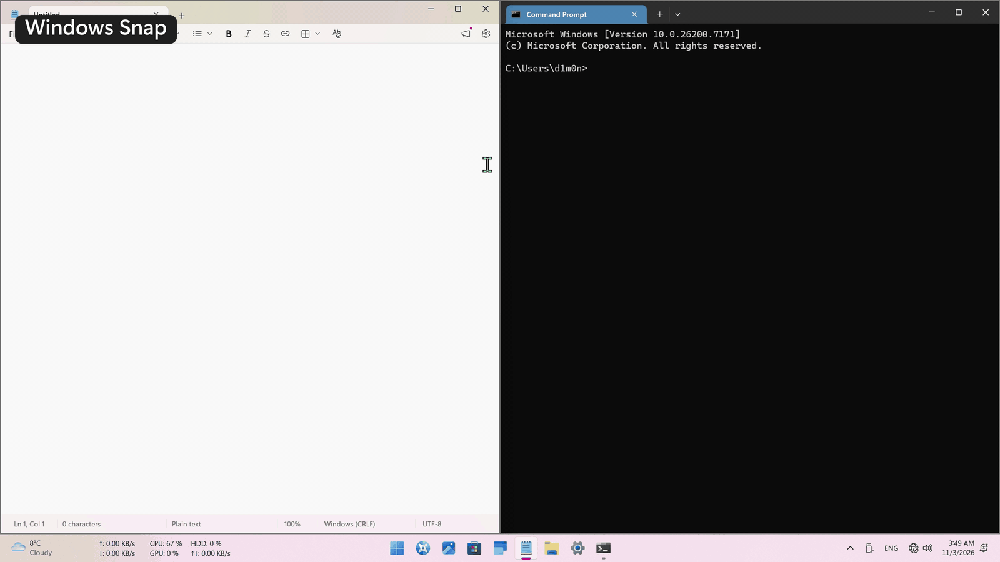

<h1 align="center">Enhanced Snap</h1>

The Windows Snap replacement for Windows 11: the same gestures, layouts and snap groups, with rounded corners, even spacing and Fluent 2 materials.

<a href="README.zh-TW.md">正體中文</a> · <a href="docs/USAGE.md">Usage</a> · <a href="docs/ENERGY.md">Energy &amp; rendering</a> · <a href="docs/LIMITATIONS.md">Limitations</a> · <a href="docs/DESIGN.md">Design</a> · <a href="docs/BUILDING.md">Build</a> · <a href="docs/ROADMAP.md">Roadmap</a> · <a href="CHANGELOG.md">Changelog</a> · <a href="PRIVACY.md">Privacy</a>

---

## Why

Windows 11 rounds window corners, and apps such as Microsoft Edge now draw their own rounded, inset content
frame. Windows Snap still tiles windows edge to edge and switches them to **square corners** while snapped,
so a multi-window desktop ends up with doubled borders, square frames around rounded content, and no breathing
room.

Enhanced Snap snaps windows into zones **with Fluent spacing between them, and keeps every window's 8 px
rounded corners**, using an overlay that follows Windows 11's own materials and motion.

## Replaces Windows Snap

While Enhanced Snap runs it **turns Windows Snap off and does the job itself**, and gives it back the moment
Enhanced Snap is paused, quits or is uninstalled (after a crash, on its next start). Windows that Windows Snap already
arranged become Enhanced Snap groups.

| Windows Snap | Enhanced Snap |
| --- | --- |
| Snap layouts on the maximize button and <kbd>Win</kbd> + <kbd>Z</kbd> | The same flyout, with Windows' layouts and **snap suggestions** in Windows' own look, plus a full-size preview of the zone you point at |
| Drag to a side, a corner or the top; the snap bar | The same gestures, and windows **keep their rounded corners and spacing** |
| Snap Assist | Live thumbnails in the remaining zones; mouse or keyboard |
| Snap groups in taskbar previews, <kbd>Alt</kbd> + <kbd>Tab</kbd> and Task View | The same **Group \| …** entries — peek from the taskbar, click to bring the group back, **X closes all its windows** — listed first when you switch from one of its windows |
| A group's empty zone stays empty until Snap Assist runs again | **Drag any window into the empty space** and it joins the group |
| A divider on the seam between two windows | An acrylic divider on **every gap**, and no window is squeezed below its minimum size |
| Snaps apps running as administrator | The same, after one prompt (installer and ZIP versions) |
| Square corners, edge to edge | An Edge-style **frame behind each group** in Mica, Mica Alt, Acrylic or a solid color |

## More than Windows Snap

- **Spacing you set** – between windows and around the screen edges, scaled for each monitor's DPI; every window's
  visible frame lands on its zone to the pixel.
- **Layouts for each monitor** – 11 templates, from halves and thirds to a center focus for ultrawide screens and rows
  for portrait ones, plus your own columns and rows.
- **Zones on demand** – hold <kbd>Shift</kbd> while dragging to see every zone; add <kbd>Ctrl</kbd> to span several.
- **Keyboard** – <kbd>Win</kbd> + arrow keys move a window between zones and across monitors; <kbd>Win</kbd> +
  <kbd>↑</kbd> fills the screen *with* rounded corners (press again to maximize).
- **Live** – change the spacing or a layout and snapped windows re-flow at once; they stay in their zones when the
  resolution, taskbar or monitors change.
- **Restore on unsnap** – drag a snapped window out and it gets its original size back.
- **Light** – no timers or polling while idle, about 7 MB of memory ([energy and rendering](docs/ENERGY.md)).
- **Private** – no telemetry and no network connections ([privacy](PRIVACY.md)).
- **Excluded apps**, **launch at sign-in**, **English / 繁體中文 / 简体中文**.

## License

[MIT](LICENSE). Enhanced Snap is an independent project and is not affiliated with Microsoft.
