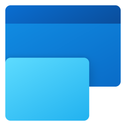

<p align="center"></p>

<h1 align="center">Enhanced Snap</h1>

<p align="center">The Windows Snap replacement for Windows 11: the same gestures, layouts and snap groups,<br>with rounded corners, even spacing and Fluent 2 materials.</p>

<p align="center"><a href="../../releases/latest">Download</a> · <a href="README.zh-TW.md">繁體中文</a> · <a href="docs/DESIGN.md">Design</a> · <a href="docs/ROADMAP.md">Roadmap</a> · <a href="CHANGELOG.md">Changelog</a> · <a href="PRIVACY.md">Privacy</a></p>

---

## Why

Windows 11 rounds window corners, and apps such as Microsoft Edge now draw their own rounded, inset content
frame. Windows Snap still tiles windows edge to edge and switches them to **square corners** while snapped,
so a multi-window desktop ends up with doubled borders, square frames around rounded content, and no breathing
room.

Enhanced Snap snaps windows into zones **with Fluent spacing between them, and keeps every window's 8 px
rounded corners**, using an overlay that follows Windows 11's own materials and motion.

## Replaces Windows Snap

While Enhanced Snap runs it **turns Windows Snap off and does the job itself** — and gives it back the moment
Enhanced Snap is paused, quits, or is uninstalled (a crash is recovered on the next start, too).

| Windows Snap | Enhanced Snap |
| --- | --- |
| Maximize-button / Win + Z snap layouts | The same flyout — Windows' layouts for your screen and **snap suggestions** (the window beside your recent apps, their icons in the zones; one click snaps them all) — in Windows' own look in light and dark, plus a full-size on-screen preview of the hovered zone |
| Drag to sides, corners, top; snap bar | Same gestures; windows keep rounded corners and Fluent spacing |
| Snap Assist | Live thumbnails in the remaining zones; mouse or keyboard |
| Snap groups when hovering an app on the taskbar | Same place: the app's taskbar preview shows **Group \| …** with the arrangement; resting on it shows the group's windows in place (peek), clicking brings the whole group back, and **X closes all its windows** |
| Snap groups in Alt + Tab and Task View | Same: each group is listed as **Group \| …** with a picture of its arrangement over the wallpaper — **first**, when you press Alt + Tab or Win + Tab in one of its windows; pick it to bring the whole group back, X closes its windows |
| A group's empty zone stays empty until Snap Assist runs again | **Drag any window over the empty space** of a group: a preview shows where it goes, and dropping it joins the group there |
| A divider appears when you hover the seam between windows | Same, as an **acrylic bar with a grip**; every gap is a divider (horizontal, vertical, between small windows). While dragging, the other windows become wallpaper placeholders, and no window is squeezed below its own minimum size |
| Snaps windows of apps running as administrator | Same, with *Snap apps running as administrator* (Windows asks once) |
| Square corners, edge-to-edge | **Edge-style frame** behind the group in **Mica, Mica Alt, Acrylic or a solid color**, following the theme; it never takes a click |

Windows already arranged by Windows Snap are adopted as Enhanced Snap groups when it takes over.

## Features

- **Drag to snap** – drag to a side (half), a corner (quarter) or the top (rounded fill); drop on the snap bar at the
  top centre for any layout. Hold <kbd>Shift</kbd> for the full zones overlay; add <kbd>Ctrl</kbd> to span zones.
- **Rounded, gapped layouts** – configurable space between windows and around the screen edges (scaled per
  monitor DPI). Snapped windows stay in the normal window state, so Windows keeps their rounded corners;
  their visible frame lands on the zone pixel-exactly (invisible resize borders are compensated).
- **Keyboard** – <kbd>Win</kbd>+<kbd>←</kbd>/<kbd>→</kbd> moves between zones and across monitors,
  <kbd>Win</kbd>+<kbd>↑</kbd> fills the screen *with* rounded corners (press again to really maximize),
  <kbd>Win</kbd>+<kbd>↓</kbd> goes back or unsnaps to the original size.
- **Layouts per monitor** – 11 templates (halves, thirds, 2/3 + 1/3, center focus for ultrawides,
  main + stack, half + two stacked, quarters, six grid, rows for portrait screens, fill) and your own column/row layouts.
- **Live** – change the spacing, corners or a layout and already snapped windows re-flow instantly; they also
  stay in their zones when the resolution, taskbar or monitors change.
- **Restore on unsnap** – dragging a snapped window out gives it back its original size.
- **Excluded apps**, **launch at sign-in**, **English / 繁體中文 / 简体中文**.
- **Energy aware** – see below.

## Install

| Where | Package | Notes |
| --- | --- | --- |
| **Microsoft Store** | Enhanced Snap | Installs and updates through the Store; starts at sign-in (listed in *Settings → Apps → Startup*). Doesn't offer *Snap apps running as administrator*. |
| [**GitHub Releases**](../../releases/latest) | `EnhancedSnap-<version>-x64.msi` | Per-user install (no admin prompt) into `%LOCALAPPDATA%\Programs\Enhanced Snap`, Start menu shortcut, launches at sign-in, clean uninstall from *Settings → Apps*. Replaces any earlier preview build. |
| | `EnhancedSnap-<version>-x64-portable.zip` | Unzip anywhere and run `EnhancedSnap.exe`. Enable *Launch at sign-in* in Settings if you want it. |

Requirements: **Windows 11** (build 22000 or later), x64. Nothing else — the .NET code is compiled to native
code and the Windows App SDK is bundled.

> The GitHub downloads are not code-signed yet, so SmartScreen may ask for confirmation on first launch
> (*More info → Run anyway*). Verify them with `SHA256SUMS.txt`. The Store version is signed by Microsoft.

## Use

| Shortcut | Action |
| --- | --- |
| Drag to a side / corner / top | Half / quarter / rounded fill; top centre opens the snap bar |
| Hover the maximize button, <kbd>Win</kbd> + <kbd>Z</kbd> | Snap layouts flyout |
| Hover a gap inside a group, then drag the bar | Resize all adjoining windows together (each stops at its app's minimum size and at a quarter of the display's shorter side) |
| Drag a window over a group's empty space | Join the group in that space |
| <kbd>Alt</kbd> + <kbd>Tab</kbd>, <kbd>Win</kbd> + <kbd>Tab</kbd> | Pick **Group \| …** to bring a whole snap group back (listed first while you're in the group) |
| X on **Group \| …** (taskbar preview, Alt + Tab, Task View) | Close every window of the group |
| <kbd>Shift</kbd> + drag | Show zones and drop the window into one (or *always* show zones; then Shift moves freely) |
| <kbd>Ctrl</kbd> while dragging | Span from the first zone to the current one |
| <kbd>Win</kbd> + <kbd>←</kbd> / <kbd>→</kbd> | Zone on the left / right (continues onto the next monitor) |
| <kbd>Win</kbd> + <kbd>↑</kbd> | Zone above, or fill the screen with rounded corners; again = maximize |
| <kbd>Win</kbd> + <kbd>↓</kbd> | Zone below, back from fill, or unsnap to the original size |

Click the tray icon to open **Settings**; right-click for *Layouts*, *Pause snapping* and *Quit*.
Running `EnhancedSnap.exe` again also opens Settings.

## Energy, rendering and materials

- **Idle = asleep.** The engine waits in `GetMessage` with no timers or polling. Window drags are observed with an
  out-of-context WinEvent hook (no DLL injection); per-drag hooks and a 33 ms modifier check exist only while a
  window is actually being dragged. For maximize-button hover, mouse moves only reset a timer; the button is
  checked once, after the pointer has rested for 300 ms.
- **Efficiency mode, small footprint.** The engine process runs with EcoQoS and opts its thread into HighQoS only
  during a drag. Popup text is drawn with Windows' software renderer, so the engine never loads the graphics driver.
  Measured on the development machine: 6.8 MB private memory at idle, about 12 MB with a snap group and its
  thumbnails.
- **Snap groups at rest cost nothing**: the base, dividers and placeholders are composition visuals; Mica comes from
  the system's blurred wallpaper, sampled once. A group's thumbnail (taskbar, Alt + Tab, Task View) is drawn once in
  the background when the group forms or changes — never on a timer — and handed to Windows instantly when asked. The
  full-screen picture a peek needs is captured only when a taskbar preview with the group opens (16 MB at
  2560 × 1600) and freed 20 seconds later.
- **GPU composition.** Zones are `Windows.UI.Composition` visuals composed by DWM; fades and the gliding drop
  target are compositor animations, so they cost no CPU in Enhanced Snap. Overlay windows are created lazily.
- **Materials follow Fluent 2.** Transient zones use **Acrylic** (host-backdrop blur + tint); the settings window
  uses **Mica**. Acrylic automatically falls back to a solid color in **Energy saver**, with transparency effects
  off, in high contrast and in Remote Desktop — and animations stop in Energy saver or when Windows animation
  effects are off. You can also force *Solid* and *No animations*.
- **The settings app is a separate process** (WinUI 3) that only runs while its window is open. Five seconds after it
  goes to the background it switches to efficiency mode and gives its memory back to Windows (measured: 93 MB in
  front → 1.5 MB private working set in the background).

## Settings & logs

- Settings: `%LOCALAPPDATA%\EnhancedSnap\settings.json` (human-readable; changes apply live)
- Logs: `%LOCALAPPDATA%\EnhancedSnap\logs\` (lifecycle and errors only)
- Microsoft Store version: Windows keeps both in the app's own folder,
  `%LOCALAPPDATA%\Packages\<package>\LocalCache\Local\EnhancedSnap`, and removes them with the app.
  *Settings → About → Open settings folder* opens the right one either way.

Nothing leaves your PC: Enhanced Snap has no telemetry and makes no network connections ([privacy](PRIVACY.md)).

## Known limitations

- **Windows of apps running as administrator** (admin terminals, Task Manager) can only be moved by an elevated
  process. Turn on *Snap apps running as administrator*: Windows asks once, then a scheduled task starts Enhanced
  Snap elevated (at sign-in too). This needs your account to be an administrator, and the installer or ZIP version:
  the Microsoft Store version can't start itself elevated, so it leaves those windows alone.
- With *Replace Windows Snap* on, the "Snap windows" switch in Windows Settings shows **Off** while Enhanced Snap
  runs — that is the takeover. Quitting or pausing Enhanced Snap switches it back on. If a run was killed and the
  switch stayed off, start Enhanced Snap once (or run `EnhancedSnap.exe --restore-snap`). The Microsoft Store
  version never saves the change to your profile, so signing out restores Windows Snap as well.
- Taskbar previews find an app's button by its AppUserModelID. Apps that set that ID for their whole process
  (for example VS Code and some other Electron apps) can't be matched from outside, so their previews don't show the
  group, and a group made only of such apps isn't listed in Alt + Tab or Task View; the group still works everywhere
  else.
- Group thumbnails in Alt + Tab and Task View are pictures taken when the group last changed or was last used, not
  live video like Windows' own (a peek is captured when it starts).
- In an app's taskbar preview the group comes after the app's windows: Windows lists them in the order they opened,
  and the only way for another program to reorder that list (removing and re-adding the windows) erases their badges
  and progress bars. Alt + Tab and Task View do list the group first when opened with Alt + Tab or Win + Tab from one
  of its windows; opened with the mouse or a touchpad gesture, Task View places it by when it was last used.
- "Close all windows" on an app's taskbar button also reaches the group previews filed under it, so every window of
  the groups that app is in is asked to close as well — other apps' windows in those groups included.
- Apps that don't use the standard Windows move loop (e.g. dragging a browser *tab* out, some games and
  remote-desktop clients) don't trigger zones.

## Build from source

Requirements: .NET 10 SDK, Visual Studio 2022/2026 with *Desktop development with C++* (NativeAOT linker),
Windows 11 SDK (for the MSIX).

```powershell
./build.ps1                    # tests → NativeAOT publish → artifacts/dist/*.zip, *.msi, SHA256SUMS.txt (GitHub)
                               #   and artifacts/store/*.msix (Microsoft Store upload)
./build.ps1 -Version 1.0.1     # default: <Version> in Directory.Build.props
python tools/make_icons.py     # re-render every icon asset from the one design (Pillow, NumPy)
```

Releasing to GitHub and the Microsoft Store: [docs/PUBLISHING.md](docs/PUBLISHING.md).

| Project | Purpose |
| --- | --- |
| `src/EnhancedSnap.Core` | Settings model, layout catalog, zone geometry, displays, localization (unit tested) |
| `src/EnhancedSnap` | `EnhancedSnap.exe` — background engine: hooks, overlay, placement, tray (NativeAOT, no UI framework) |
| `src/EnhancedSnap.Settings` | `EnhancedSnap.Settings.exe` — WinUI 3 settings app (NativeAOT, self-contained) |
| `tests/EnhancedSnap.Core.Tests` | xUnit tests for geometry, navigation, settings |
| `installer/` | WiX v5 per-user MSI |
| `packaging/` | MSIX for the Microsoft Store: manifest template, logos, store identity, `build-msix.ps1` |
| `tools/` | Icon generator and live-desktop test probes (not shipped) |

Extension points for future updates are marked with `UPDATE:` comments in the code and collected in
[docs/ROADMAP.md](docs/ROADMAP.md).

## License

[MIT](LICENSE). Enhanced Snap is an independent project and is not affiliated with Microsoft.