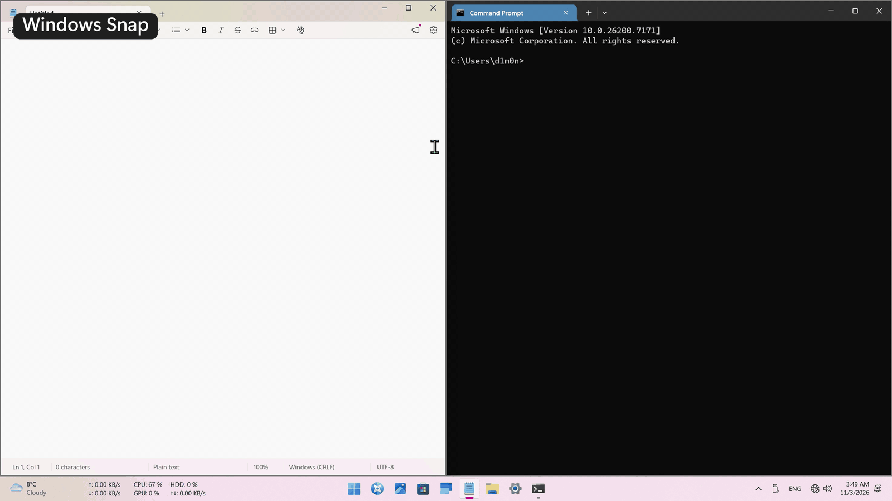

<h1 align="center">Enhanced Snap</h1>

Windows 11 上 Windows 贴靠的替代方案：同样的手势、布局和贴靠组， 再加上圆角、均匀的间距和 Fluent 2 材质。

<a href="https://apps.microsoft.com/detail/9p14s84633ll"><b>从 Microsoft Store 获取</b></a> · 或从 <a href="https://github.com/VikaKumaChR/EnhancedSnap/releases/latest">GitHub Releases</a> 下载（<a href="#下载">先看这里</a>）

<a href="README.md">English</a> · <a href="README.zh-TW.md">正體中文</a> · 文档（英文）：<a href="docs/USAGE.md">使用方法</a> · <a href="docs/ENERGY.md">节能与渲染</a> · <a href="docs/LIMITATIONS.md">已知限制</a> · <a href="docs/DESIGN.md">设计</a> · <a href="docs/BUILDING.md">构建</a> · <a href="docs/ROADMAP.md">路线图</a> · <a href="CHANGELOG.md">更新日志</a> · <a href="PRIVACY.md">隐私</a> · <a href="docs/CODE_SIGNING.md">代码签名</a>

---

## 为什么需要它

Windows 11 的窗口是圆角的，Microsoft Edge 等应用也开始自己绘制圆角、向内缩进的内容框。
但 Windows 贴靠仍然让窗口**一个挨一个、没有任何间距**地排列，而且贴靠后会把窗口变成**直角**。
同时开着几个窗口时，就会出现双层边框、直角外框套着圆角内容、界面拥挤等问题。

Enhanced Snap 把窗口贴靠到**留有 Fluent 间距的区域，并保留每个窗口 8 px 的圆角**；
贴靠时显示的叠加层也沿用 Windows 11 自己的材质和动画。

## 替代 Windows 贴靠

Enhanced Snap 运行时会**关闭 Windows 贴靠，由自己接手**；暂停、退出或卸载时会立即恢复（如果程序异常退出，下次启动时也会恢复）。
接手时，已经由 Windows 贴靠排列好的窗口会自动转为 Enhanced Snap 的贴靠组。

| Windows 贴靠 | Enhanced Snap |
| :-: | :-: |
| 最大化按钮和 <kbd>Win</kbd>＋<kbd>Z</kbd> 的贴靠布局 | 同样的弹出菜单，提供 Windows 的布局和**贴靠建议**，外观与 Windows 一致；指针停在区域上时，还会在屏幕上预览窗口的实际位置；**与拖到顶部时的菜单使用同一组布局** |
| 拖动到侧边、角落或顶部；屏幕顶部的贴靠布局 | 同样的手势，窗口**保留圆角和间距**；窗口拖近顶部时，菜单先在顶部露出一截，指针到达顶部中央时再完全展开 |
| 屏幕顶部的贴靠布局总是只有固定几种 | **在贴靠布局菜单里放你自己的布局**：默认、上下分割，以及最多 12 个布局的自定义组合；把指针停在组合名称上即可切换，拖动时也可以转动鼠标滚轮 |
| 贴靠助手 | 在剩余区域显示其他窗口的实时缩略图，可以用鼠标或键盘选择 |
| 任务栏预览、<kbd>Alt</kbd>＋<kbd>Tab</kbd> 和任务视图中的贴靠组 | 同样的 **组 \| …** 条目：可以从任务栏预览整组窗口，单击即可让整组回到前面，**点 X 会关闭组内的所有窗口**；从组内窗口切换时排在最前面 |
| 贴靠组中的空区域要等贴靠助手再次出现才能补上 | **把任意窗口拖到空位上**，它就会加入贴靠组 |
| 两个窗口接缝上的分隔线 | **每个间隙**都有亚克力分隔条，任何窗口都不会被压到小于它的最小尺寸 |
| 可以贴靠以管理员身份运行的应用 | 同样可以，Windows 只询问一次（安装版和免安装版） |
| 直角、一个挨一个 | 每个贴靠组后方都有 Edge 风格的**底板**，可选云母、云母 Alt、亚克力或纯色 |

## 不只是 Windows 贴靠

- **间距由你设置**：窗口之间和屏幕边缘的距离都可以调整（按各显示器的 DPI 缩放），每个窗口的可见边框都会精确落在区域边界上。
- **每个显示器各自的布局**：14 种模板，从左右平分、三等分，到超宽屏的中央焦点和竖屏的上下平分，也可以自定义列和行。
- **需要时才显示区域**：拖动时按住 <kbd>Shift</kbd> 显示所有区域，再按住 <kbd>Ctrl</kbd> 可以跨越多个区域。
- **键盘**：<kbd>Win</kbd>＋方向键在区域之间（以及在显示器之间）移动窗口；<kbd>Win</kbd>＋<kbd>↑</kbd> 以**圆角填满**整个屏幕（再按一次才最大化）。
- **即时生效**：调整间距或布局时，已贴靠的窗口会立即重新排列；分辨率、任务栏或显示器变化时，窗口也会留在原来的区域。
- **取消贴靠时恢复大小**：把已贴靠的窗口拖出来，它会恢复原来的大小。
- **轻量**：空闲时没有计时器、不轮询，内存占用约 7 MB（[节能与渲染](docs/ENERGY.md)，英文）。
- **注重隐私**：没有遥测，也不会连接网络（[隐私](PRIVACY.md)，英文）。
- **排除的应用**、**登录时启动**、**English／繁體中文／简体中文** 界面。

## 下载

- **[Microsoft Store](https://apps.microsoft.com/detail/9p14s84633ll)**（推荐）：通过 Store 安装和更新。Store 版由 Microsoft
  签名，Windows 不会对它显示 SmartScreen 警告。
- **[GitHub Releases](https://github.com/VikaKumaChR/EnhancedSnap/releases/latest)**：`EnhancedSnap-<版本>-x64.msi`（为当前用户安装，
  不需要管理员权限）或免安装版 ZIP。这些文件目前还没有代码签名，所以 Microsoft Edge 可能提示文件不常被下载，Chrome 可能把它标为不常见，
  Windows 可能显示 SmartScreen 的蓝色窗口（英文版标题 *Windows protected your PC*）、发布者未知，开着 Smart App Control 时也可能被拦下。
  这表示 Windows 还不认识这个文件，并不是在文件里发现了什么。
- **打开 GitHub 下载的文件前先验证**：在下载文件夹打开 PowerShell，运行 `Get-FileHash .\EnhancedSnap-<版本>-x64.msi`，
  哈希值要和 Release 页面上文件旁边的 SHA-256 以及 `SHA256SUMS.txt` 里对应的一行完全相同；不同就删除文件。
  如果 Smart App Control 拦下它，无法对单个应用放行，请改用 Store 版。

## 许可证

[MIT](LICENSE)。Enhanced Snap 是独立项目，与 Microsoft 无关。
