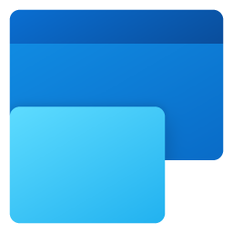

<p align="center"></p>

<h1 align="center">Enhanced Snap</h1>

<p align="center">Windows 11 的 Windows 貼齊替代方案：相同的手勢、版面配置與貼齊群組，<br>再加上圓角、等距間隔與 Fluent 2 材質。</p>

<p align="center"><a href="../../releases/latest">下載</a> · <a href="README.md">English</a> · <a href="docs/DESIGN.md">設計文件</a> · <a href="docs/ROADMAP.md">後續更新</a> · <a href="CHANGELOG.md">更新記錄</a> · <a href="PRIVACY.md">隱私權</a></p>

---

## 為什麼需要它

Windows 11 的視窗是圓角，Microsoft Edge 等應用程式也開始自行繪製圓角、內縮的內容框；
但 Windows Snap 仍然把視窗貼得**邊對邊、毫無間距**，而且貼齊後會變成**直角**。
多視窗工作時就會出現雙重邊框、直角外框包著圓角內容、畫面擁擠等問題。

Enhanced Snap 讓視窗貼齊到**保有 Fluent 間距的區域，並保留每個視窗 8 px 的圓角**；
貼齊時的疊加層也遵循 Windows 11 本身的材質與動態設計。

## 取代 Windows 貼齊

Enhanced Snap 執行時會**關閉 Windows 貼齊並由自己接手**；暫停、結束或解除安裝時立即還原（若程式異常結束，下次啟動時也會自動還原）。

| Windows 貼齊 | Enhanced Snap |
| :-: | :-: |
| 最大化按鈕／Win + Z 的貼齊版面配置 | 相同的浮出視窗：依螢幕大小提供與 Windows 相同的版面配置，並有**貼齊建議**（目前視窗搭配最近使用的應用程式，區域中顯示其圖示，按一下就全部貼齊）；淺色與深色主題下都與 Windows 原生外觀一致，停在區域上時還會在螢幕上預覽實際位置 |
| 拖曳到側邊、角落、頂端；貼齊列 | 相同手勢，且視窗保留圓角與 Fluent 間距 |
| 貼齊輔助 | 在剩餘區域顯示其他視窗的即時縮圖，可用滑鼠或鍵盤選擇 |
| 指標停在工作列上的應用程式時顯示貼齊群組 | 同樣的位置：應用程式的工作列預覽中會出現 **群組 \| …** 與排列縮圖；指標停在上面會在原位顯示群組的視窗（預覽），按一下即可還原整個群組，**按 X 會關閉群組中的所有視窗** |
| Alt + Tab 與工作檢視中的貼齊群組 | 相同：每個群組都會以 **群組 \| …** 列出，並附上排列在桌布上的縮圖——在群組的視窗中按 Alt + Tab 或 Win + Tab 時**排在第一個**；選取即可還原整個群組，按 X 會關閉群組的視窗 |
| 群組中的空區域要等貼齊輔助再次出現才能補上 | **把任何視窗拖到群組的空位上**：會預覽它的位置，放開即加入群組並填滿空位 |
| 指標停在視窗接縫上時出現分隔線 | 相同，並以**帶握把的壓克力分隔條**呈現；每個間隙都是分隔線（橫向、縱向、小視窗之間也可以）。拖曳時其他視窗會變成桌布預留位置，任何視窗都不會被壓到低於其最小尺寸 |
| 可貼齊以系統管理員身分執行的應用程式 | 相同，開啟「貼齊以系統管理員身分執行的應用程式」（Windows 只詢問一次） |
| 直角、邊對邊 | 群組後方的 **Edge 風格底板**，可選**雲母、雲母 Alt、壓克力或純色**並跟隨主題；底板不會攔截任何點擊 |

接手時，已由 Windows 貼齊排列好的視窗會自動轉為 Enhanced Snap 群組。

## 功能

- **拖曳貼齊**：拖曳到側邊（一半）、角落（四分之一）或頂端（圓角填滿）；拖到頂端中央的貼齊列可選擇任何版面配置。
  按住 <kbd>Shift</kbd> 會顯示完整的壓克力區域，強調色的放置目標會平滑地移到指標所在的區域；再按住 <kbd>Ctrl</kbd> 可跨越多個區域。
- **圓角＋間距**：可調整視窗之間與畫面邊緣的距離（依各顯示器 DPI 縮放）。貼齊後視窗維持一般狀態，
  因此 Windows 會保留圓角；視窗的可見外框會**精準對齊**區域（已補償隱形的調整大小邊框）。
- **鍵盤**：<kbd>Win</kbd>+<kbd>←</kbd>/<kbd>→</kbd> 在區域間（以及跨顯示器）移動；
  <kbd>Win</kbd>+<kbd>↑</kbd> 以**圓角填滿**整個畫面（再按一次才真正最大化）；
  <kbd>Win</kbd>+<kbd>↓</kbd> 返回或取消貼齊並恢復原本大小。
- **每個顯示器各自的版面配置**：11 種範本（左右各半、三等分、2/3＋1/3、超寬螢幕的中央焦點、主視窗與堆疊、一半與上下兩格、
  四等分、六宮格、直式螢幕的上下各半、填滿），也可以自訂欄與列。
- **即時套用**：調整間距、圓角或版面配置時，已貼齊的視窗會立即重新排列；解析度、工作列或顯示器變更時也會保持在原區域。
- **取消貼齊時還原大小**：把已貼齊的視窗拖出來，會恢復成原本的大小。
- **排除的應用程式**、**登入時啟動**、**English／繁體中文／简体中文**。
- **節能設計**：見下方說明。

## 安裝

| 管道 | 檔案 | 說明 |
| --- | --- | --- |
| **Microsoft Store** | Enhanced Snap | 由 Store 安裝與更新；登入時啟動（列在「設定 → 應用程式 → 啟動」）。不提供「貼齊以系統管理員身分執行的應用程式」。 |
| [**GitHub Releases**](../../releases/latest) | `EnhancedSnap-<版本>-x64.msi` | 以目前使用者安裝（不需系統管理員權限）到 `%LOCALAPPDATA%\Programs\Enhanced Snap`，建立開始功能表捷徑、登入時啟動，可從「設定 → 應用程式」乾淨解除安裝；會取代先前的預覽版。 |
| | `EnhancedSnap-<版本>-x64-portable.zip` | 免安裝版：解壓縮後執行 `EnhancedSnap.exe`；如需開機啟動，請在設定中開啟「登入時啟動」。 |

系統需求：**Windows 11**（組建 22000 以上）、x64。不需要另外安裝任何執行環境
（.NET 程式碼已編譯為原生程式碼，Windows App SDK 也已內含）。

> GitHub 下載的檔案目前尚未進行程式碼簽章，第一次執行時 SmartScreen 可能會要求確認（「其他資訊 → 仍要執行」）。
> 可用 `SHA256SUMS.txt` 驗證下載的檔案。Store 版由 Microsoft 簽章。

## 使用方式

| 操作 | 動作 |
| --- | --- |
| 拖曳到側邊／角落／頂端 | 一半／四分之一／圓角填滿；頂端中央會開啟貼齊列 |
| 指標停在最大化按鈕上、<kbd>Win</kbd>＋<kbd>Z</kbd> | 貼齊版面配置浮出視窗 |
| 指標停在群組的間隙上，再拖曳分隔條 | 一起調整所有相鄰視窗的大小（每個視窗最小只到其應用程式的最小尺寸，以及顯示器短邊的四分之一） |
| 把視窗拖到群組的空位上 | 加入群組並填滿該空位 |
| <kbd>Alt</kbd>＋<kbd>Tab</kbd>、<kbd>Win</kbd>＋<kbd>Tab</kbd> | 選取 **群組 \| …** 即可還原整個貼齊群組（在群組中時排在第一個） |
| 在 **群組 \| …** 上按 X（工作列預覽、Alt＋Tab、工作檢視） | 關閉群組中的所有視窗 |
| <kbd>Shift</kbd>＋拖曳 | 顯示區域並把視窗放進去（也可設定為「一律顯示」，此時按住 Shift 則可自由移動） |
| 拖曳時按 <kbd>Ctrl</kbd> | 從第一個區域跨越到目前的區域 |
| <kbd>Win</kbd>＋<kbd>←</kbd>／<kbd>→</kbd> | 移到左／右側的區域（到邊緣時繼續移到下一個顯示器） |
| <kbd>Win</kbd>＋<kbd>↑</kbd> | 上方區域，或以圓角填滿畫面；再按一次＝最大化 |
| <kbd>Win</kbd>＋<kbd>↓</kbd> | 下方區域、從填滿返回，或取消貼齊並恢復原本大小 |

按一下系統匣圖示開啟**設定**；按右鍵可選擇「版面配置」「暫停貼齊」「結束」。
再次執行 `EnhancedSnap.exe` 也會開啟設定。

## 節能、渲染與材質

- **閒置＝休眠**：背景引擎停在 `GetMessage` 等待，沒有計時器、不輪詢。以 out-of-context WinEvent hook 偵測視窗拖曳
  （不注入 DLL）；只有在真正拖曳視窗的期間，才會有針對該視窗的 hook 與 33 ms 的修飾鍵檢查。
- **效率模式、低占用**：引擎程序以 EcoQoS 執行，只在拖曳期間把執行緒切換為 HighQoS。浮出視窗的文字使用 Windows 的軟體轉譯器繪製，
  引擎完全不載入顯示卡驅動程式。開發機實測：閒置時私有記憶體 6.8 MB，有一個貼齊群組及其縮圖時約 12 MB。
- **貼齊群組靜止時不耗資源**：底板、分隔線與預留位置都是合成視覺物件；雲母取自系統已模糊的桌布（只取樣一次）。
  群組縮圖（工作列、Alt + Tab、工作檢視）只在群組建立或變動時於背景繪製一次——從不定時重繪——Windows 要求時立即交出。
  預覽（指標停在縮圖上）所需的全螢幕畫面只在含有群組的工作列預覽開啟時擷取（2560 × 1600 時約 16 MB），20 秒後即釋放。
- **GPU 合成**：區域使用 `Windows.UI.Composition` 視覺物件，由 DWM 在 GPU 上合成；淡入淡出與滑動的放置目標
  都是合成器動畫，不佔用 Enhanced Snap 的 CPU。疊加層視窗在第一次需要時才建立。
- **材質遵循 Fluent 2**：短暫出現的區域使用**壓克力**（Host Backdrop 模糊＋色調），設定視窗使用**雲母 (Mica)**。
  在**節能模式**、關閉透明效果、高對比與遠端桌面時，壓克力會自動改為純色；節能模式或關閉 Windows 動畫效果時也會停止動畫。
  也可以手動選擇「純色」與「關閉動畫」。
- **設定程式是獨立程序**（WinUI 3），只有在視窗開啟時才會執行。視窗移到背景 5 秒後會切換為效率模式並把記憶體還給 Windows
  （實測：前景 93 MB → 背景時私有工作集 1.5 MB）。

## 設定檔與記錄

- 設定：`%LOCALAPPDATA%\EnhancedSnap\settings.json`（可直接閱讀，變更即時生效）
- 記錄：`%LOCALAPPDATA%\EnhancedSnap\logs\`（只記錄啟動、結束與錯誤）
- Microsoft Store 版：Windows 會把兩者放在應用程式自己的資料夾
  `%LOCALAPPDATA%\Packages\<套件>\LocalCache\Local\EnhancedSnap`，並在移除應用程式時一併刪除。
  「設定 → 關於 → 開啟設定資料夾」一律會開啟正確的位置。

所有資料都留在您的電腦上：Enhanced Snap 沒有遙測，也不會連線到網路（[隱私權](PRIVACY.md)）。

## 已知限制

- **以系統管理員身分執行的應用程式視窗**（系統管理員終端機、工作管理員）只有提升權限的程序才能移動。
  開啟「貼齊以系統管理員身分執行的應用程式」：Windows 只詢問一次，之後由排程工作以系統管理員權限啟動 Enhanced Snap（登入時也是）。
  您的帳戶需為系統管理員，且需使用安裝程式或免安裝版：Microsoft Store 版無法以系統管理員權限啟動，因此不會移動這些視窗。
- 開啟「取代 Windows 貼齊」時，Enhanced Snap 執行期間 Windows 設定中的「貼齊視窗」會顯示為**關閉**——這就是接手；
  暫停或結束 Enhanced Snap 會自動重新開啟。若程式被強制結束導致仍為關閉，啟動一次 Enhanced Snap（或執行 `EnhancedSnap.exe --restore-snap`）即可還原。
  Microsoft Store 版不會把這項變更寫入您的設定檔，因此登出也會還原 Windows 貼齊。
- 工作列預覽依應用程式的 AppUserModelID 找到它的按鈕。為整個程序設定此 ID 的應用程式（例如 VS Code 與部分 Electron 應用程式）
  無法從外部比對，因此它們的工作列預覽不會顯示群組，只由這類應用程式組成的群組也不會出現在 Alt + Tab 與工作檢視中；群組的其他功能不受影響。
- Alt + Tab 與工作檢視中的群組縮圖是群組最後一次變動或使用時的畫面，不像 Windows 原生群組那樣即時更新（預覽則是在開始時擷取）。
- 在應用程式的工作列預覽中，群組排在該應用程式的視窗之後：Windows 依視窗開啟的順序排列，而其他程式唯一能調整順序的方式（移除再重新加入視窗）
  會清除那些視窗的徽章與進度列。從群組的視窗按 Alt + Tab 或 Win + Tab 時，群組會排在第一個；以滑鼠或觸控板手勢開啟工作檢視時，則依群組最後一次使用的時間排列。
- 在應用程式工作列按鈕上選「關閉所有視窗」，也會傳到歸在該按鈕下的群組預覽，因此該應用程式所在群組的所有視窗（包括其他應用程式的視窗）也會被要求關閉。
- 不使用標準 Windows 移動迴圈的操作（例如把瀏覽器**分頁**拖出來、部分遊戲與遠端桌面用戶端）不會顯示區域。

## 從原始碼建置

需求：.NET 10 SDK、Visual Studio 2022／2026（含「使用 C++ 的桌面開發」，NativeAOT 連結器需要）、Windows 11 SDK（MSIX 需要）。

```powershell
./build.ps1                    # 單元測試 → NativeAOT 發佈 → artifacts/dist/*.zip、*.msi、SHA256SUMS.txt（GitHub）
                               #   以及 artifacts/store/*.msix（上傳 Microsoft Store）
./build.ps1 -Version 1.0.1     # 預設：Directory.Build.props 中的 <Version>
python tools/make_icons.py     # 由同一份設計重新產生所有圖示（Pillow、NumPy）
```

發佈到 GitHub 與 Microsoft Store 的步驟：[docs/PUBLISHING.md](docs/PUBLISHING.md)。

程式碼中以 `UPDATE:` 註解標示可後續更新的擴充點，並整理於 [docs/ROADMAP.md](docs/ROADMAP.md)。

## 授權

[MIT](LICENSE)。Enhanced Snap 為獨立專案，與 Microsoft 無關。
