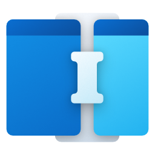
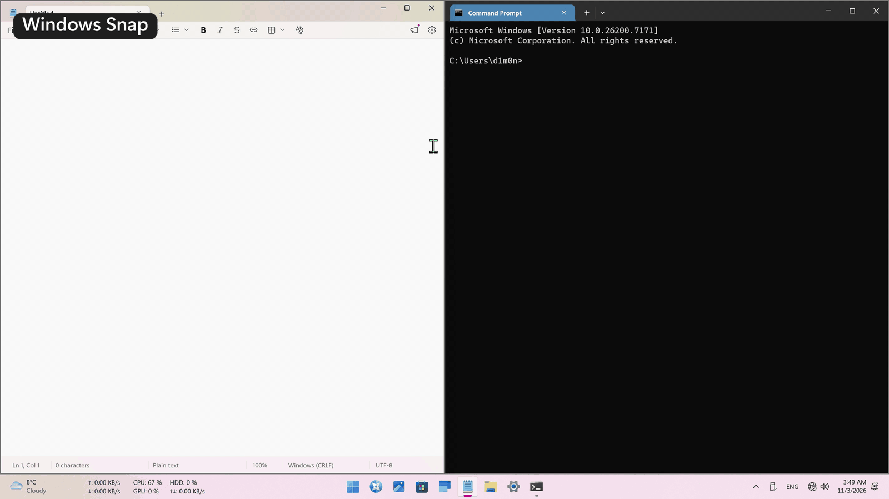

<h1 align="center">Enhanced Snap</h1>

Windows 11 的 Windows 貼齊替代方案：相同的手勢、版面配置與貼齊群組， 再加上圓角、等距間隔與 Fluent 2 材質。

<a href="https://apps.microsoft.com/detail/9p14s84633ll"><b>從 Microsoft Store 取得</b></a> · 或從 <a href="https://github.com/VikaKumaChR/EnhancedSnap/releases/latest">GitHub Releases</a> 下載（<a href="#下載">先看這裡</a>）

<a href="README.md">English</a> · <a href="README.zh-CN.md">简体中文</a> · <a href="docs/USAGE.zh-TW.md">使用方式</a> · <a href="docs/ENERGY.zh-TW.md">節能與渲染</a> · <a href="docs/LIMITATIONS.zh-TW.md">已知限制</a> · <a href="docs/DESIGN.md">設計文件</a> · <a href="docs/BUILDING.zh-TW.md">建置</a> · <a href="docs/ROADMAP.md">後續更新</a> · <a href="CHANGELOG.md">更新記錄</a> · <a href="PRIVACY.md">隱私權</a> · <a href="docs/CODE_SIGNING.md">程式碼簽章</a>

---

## 為什麼需要它

Windows 11 的視窗是圓角，Microsoft Edge 等應用程式也開始自行繪製圓角、內縮的內容框；
但 Windows Snap 仍然把視窗貼得**邊對邊、毫無間距**，而且貼齊後會變成**直角**。
多視窗工作時就會出現雙重邊框、直角外框包著圓角內容、畫面擁擠等問題。

Enhanced Snap 讓視窗貼齊到**保有 Fluent 間距的區域，並保留每個視窗 8 px 的圓角**；
貼齊時的疊加層也遵循 Windows 11 本身的材質與動態設計。

## 取代 Windows 貼齊

Enhanced Snap 執行時會**關閉 Windows 貼齊並由自己接手**；暫停、結束或解除安裝時立即還原（若程式異常結束，下次啟動時也會自動還原）。
接手時，已由 Windows 貼齊排列好的視窗會自動轉為 Enhanced Snap 群組。

| Windows 貼齊 | Enhanced Snap |
| :-: | :-: |
| 最大化按鈕與 <kbd>Win</kbd>＋<kbd>Z</kbd> 的貼齊版面配置 | 相同的浮出視窗，提供 Windows 的版面配置與**貼齊建議**，外觀與 Windows 一致；停在區域上時還會在螢幕上預覽實際位置；**與貼齊列使用同一組版面配置** |
| 拖曳到側邊、角落、頂端；貼齊列 | 相同手勢，且視窗**保留圓角與間距**；視窗拖近頂端時，貼齊列先在頂端露出一截，指標到達頂端中央再完整展開 |
| 貼齊列永遠只有固定幾種版面配置 | **貼齊版面配置選單放您自己的版面配置**：預設、上下分割，以及最多 12 個的自訂組合；把指標停在組合名稱上即可切換，拖曳時也可轉動滑鼠滾輪 |
| 貼齊輔助 | 在剩餘區域顯示其他視窗的即時縮圖，可用滑鼠或鍵盤選擇 |
| 工作列預覽、<kbd>Alt</kbd>＋<kbd>Tab</kbd> 與工作檢視中的貼齊群組 | 相同的 **群組 \| …**：可從工作列預覽群組、按一下叫回整個群組，**按 X 會關閉群組中的所有視窗**；從群組的視窗切換時排在第一個 |
| 群組中的空區域要等貼齊輔助再次出現才能補上 | **把任何視窗拖到空位上**，就會加入群組 |
| 視窗接縫上的分隔線 | **每個間隙**都有壓克力分隔條，任何視窗都不會被壓到低於最小尺寸 |
| 可貼齊以系統管理員身分執行的應用程式 | 相同，Windows 只詢問一次（安裝程式與免安裝版） |
| 直角、邊對邊 | 每個群組後方都有 Edge 風格的**底板**，可選雲母、雲母 Alt、壓克力或純色 |

## 不只是 Windows 貼齊

- **自訂間距**：可調整視窗之間與畫面邊緣的距離（依各顯示器 DPI 縮放），每個視窗的可見外框都會精準對齊區域。
- **每個顯示器各自的版面配置**：14 種範本，從左右各半、三等分，到超寬螢幕的中央焦點與直式螢幕的上下排列，也可以自訂欄與列。
- **需要時才顯示區域**：拖曳時按住 <kbd>Shift</kbd> 顯示所有區域，再按住 <kbd>Ctrl</kbd> 可跨越多個區域。
- **鍵盤**：<kbd>Win</kbd>＋方向鍵在區域間（以及跨顯示器）移動視窗；<kbd>Win</kbd>＋<kbd>↑</kbd> 以**圓角填滿**整個畫面（再按一次才最大化）。
- **即時套用**：調整間距或版面配置時，已貼齊的視窗會立即重新排列；解析度、工作列或顯示器變更時也會保持在原區域。
- **取消貼齊時還原大小**：把已貼齊的視窗拖出來，會恢復成原本的大小。
- **輕巧**：閒置時沒有計時器、不輪詢，記憶體約 7 MB（[節能與渲染](docs/ENERGY.zh-TW.md)）。
- **重視隱私**：沒有遙測，也不會連線到網路（[隱私權](PRIVACY.md)）。
- **排除的應用程式**、**登入時啟動**、**English／繁體中文／简体中文**。

## 下載

- **[Microsoft Store](https://apps.microsoft.com/detail/9p14s84633ll)**（建議）：由 Store 安裝與更新。Store 版由 Microsoft
  簽章，Windows 不會對它顯示 SmartScreen 警告。
- **[GitHub Releases](https://github.com/VikaKumaChR/EnhancedSnap/releases/latest)**：`EnhancedSnap-<版本>-x64.msi`（以目前使用者安裝，
  不需系統管理員權限）或免安裝版 ZIP。這些檔案目前尚未進行程式碼簽章，所以 Microsoft Edge 可能提示檔案不常被下載，Chrome 可能標示為不常見，
  Windows 可能顯示 SmartScreen 的藍色視窗（英文版標題 *Windows protected your PC*）、發行者不明，開著 Smart App Control 時也可能被擋下。
  這表示 Windows 還不認識這個檔案，不是在檔案裡發現了什麼。
- **開啟 GitHub 下載的檔案前先核對**：在下載資料夾開啟 PowerShell，執行 `Get-FileHash .\EnhancedSnap-<版本>-x64.msi`，
  雜湊值要和 Release 頁面上檔案旁的 SHA-256、以及 `SHA256SUMS.txt` 裡對應的那一行完全相同；不同就刪除檔案。
  若 Smart App Control 擋下它，無法針對單一 app 放行，請改用 Store 版。

## 授權

[MIT](LICENSE)。Enhanced Snap 為獨立專案，與 Microsoft 無關。
