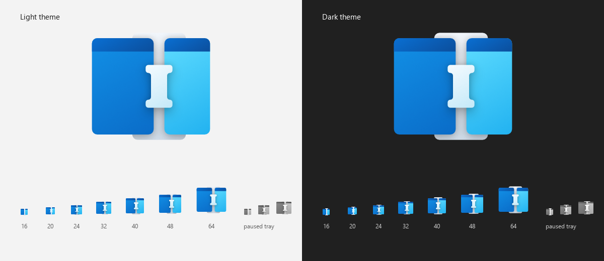

# Enhanced Snap — Design

## 1. Problem

Microsoft Edge windows arranged with Windows Snap (the screenshots the project started from):

| Observation | Cause |
| --- | --- |
| Windows touch each other and the screen edges | Windows Snap tiles without spacing |
| Snapped windows have **square** corners | DWM squares the corners of maximized and *arranged* (snapped) windows |
| Edge draws a rounded, inset content frame inside a square window | Edge adopted Fluent 2 "rounded content" (the thread in the brief: the flag that hid it is gone) |
| Doubled 1 px borders between neighbours, cramped quadrants | No gap, two borders meeting |

The mismatch isn't Edge's design; it's the window manager around it. Enhanced Snap fixes it there: windows stay
in the **normal** state (so DWM keeps the 8 px radius), are separated by **even gaps**, and the snapping UI
uses Fluent 2 materials and motion.

## 2. Fluent 2 decisions

| Token | Value | Where |
| --- | --- | --- |
| Corner radius | 8 px (Fluent *Large*, Windows 11 window radius); 4 px option (*Medium*) | Zone tiles, drop target, `DWMWA_WINDOW_CORNER_PREFERENCE` |
| Spacing | 8 epx default gap and margin, 0–32 in 2 px steps (4 px grid) | `ZoneMath.ComputeZones` |
| Strokes | 1 px tile stroke, 2 px accent stroke on the drop target (Fluent *Thin*/*Thick*), 2/3 px in high contrast | `OverlayPalette` |
| Materials | **Acrylic** for the transient zones overlay, **Mica** for the long-lived settings window, **Solid** fallback | `OverlayPalette`, `MainWindow` |
| Color | Accent: `AccentDark1` (light) / `AccentLight2` (dark) from `UISettings`; neutral tints `#F3F3F3` / `#202020` | `OverlayPalette` |
| Motion | Enter 167 ms decelerate `(0,0,0,1)`; exit 100 ms accelerate `(0.7,0,1,0.5)`; drop target glide 150 ms | `FluentMotion` |
| Theme | Zones follow the *Windows* mode (shell chrome); settings follow the app mode | `SystemState` |
| Typography/controls | WinUI 3 defaults (Segoe UI Variable, `SettingsCard`, NavigationView) | Settings app |
| Page layout | The Content Layer keeps equal space left and right at every width: 40 epx, 24 epx below 640 epx; content stretches between (Suggestion02). In NavigationView's minimal mode (windows under 640 epx) the pane button floats over the content's top-left corner, so the pages start below it | `PageContentPanel`, `MainWindow` |
| Settings page | NavigationView's own Settings item, last and pinned to the bottom ([app settings guidelines](https://learn.microsoft.com/windows/apps/design/app-settings/guidelines-for-app-settings)). *App appearance* holds Theme (system, light or dark: the settings window and its caption buttons; snapping overlays follow Windows, as Windows Snap's do) and Language. *About* holds Send feedback, the file shortcuts and Quit, then the About `SettingsExpander` last: icon, name and version in its header; license, notices, privacy and repository inside (Suggestion03) | `AppSettingsPage`, `MainWindow.ApplyTheme` |
| Desktop previews | The user's wallpaper, fitted like Windows (fill, fit, stretch, center, span, tile at the picture's own scale; EXIF-upright), in a frame with the monitor's shape, clipped to 7 epx inside the 8 epx frame. Decoded off the UI thread at about 1280 px (the preview's size; rounding the shown part out to whole pixels can add 2) and only the shown part, turned photos too: the shown rectangle is mapped back into the stored frame, decoded alone, then turned upright; a file that can't be decoded right now gives way to Windows' own copy (`TranscodedWallpaper`). The log gives the kind (picture with its extension, or solid color), fit, monitor and decoded size, never the file name. Windows and taskbar are Mica: a 48 px whole-desktop backdrop drawn stretched (the blur) under a tint (windows 80 % light / 84 % dark, the taskbar 84 % in either Windows mode), opaque under the fallbacks below. The windows follow the app mode; the taskbar follows the Windows mode, like the real one (Suggestion01_01/02) | `LayoutPreview`, `WallpaperPreview`, `WallpaperLayout` |
| Pop down sets | The snap layout menu's sets as tabs below its cards, like WinUI's `SelectorBar`: 40 epx tall (touch target) and as wide as the name, measured with DirectWrite, plus 12 epx each side (at least 64), 12 epx text (the active one semibold, the others `TextFillColorSecondary`), `SubtleFillColorSecondary` under the pointer (an outline in high contrast), a 16 × 3 epx accent bar under the active tab that glides 150 ms; new cards fade in over 167 ms, nothing moves without animations (suggestion00) | `LayoutFlyout`, `SnapBarCatalog` |

Material fallbacks mirror WinUI's own acrylic rules: solid when transparency effects are off, in Energy saver,
in high contrast (system colors only) and in Remote Desktop sessions. The Mica windows and taskbar of the settings'
desktop previews turn opaque in the same four cases.

## 3. Architecture

```
┌──────────────────────── EnhancedSnap.exe (always running, NativeAOT, ~7 MB idle) ───────────────────────┐
│ EngineHost      hidden top-level window + GetMessage loop (broadcasts, tray, IPC, power)                 │
│ WindowsSnap…    WindowsSnapOverride: SPI_SETWINARRANGING off while running, restored on every exit path  │
│ SnapEngine      WinEvent MOVESIZESTART/END → drag session → edges / snap bar / zones → WindowPlacer      │
│ GroupManager    snap groups: GroupFrame (click-through base), DividerLayer (hover bars, drag placeholders,│
│                 min-size limits), TaskbarGroups (previews in the apps' taskbar thumbnails), lifecycle    │
│ Popups          LayoutFlyout, SnapAssist (composition + Direct2D text on WARP, DWM thumbnails)          │
│ OverlayManager  one click-through ZoneOverlay per monitor (Windows.UI.Composition, DesktopWindowTarget)   │
│ InputHook       own HighQoS thread: WH_KEYBOARD_LL (Win+Arrow/Z) and WH_MOUSE_LL (maximize hover, wheel), │
│                 only while a setting needs it                                                            │
│ TrayIcon        Shell_NotifyIcon v4, themed Win32 menu                                                   │
│ Elevation       administrator mode: scheduled task, message filter, unelevated launches                  │
│ SystemState     theme, accent, transparency, animations, high contrast, RDP, Energy saver                │
└──────────────────────────────────────────────▲──────────────────────────────────────────────────────────────┘
                                               │ WM_APP messages to known window classes (no sockets, no polling)
┌──────────────────────── EnhancedSnap.Settings.exe (on demand, WinUI 3, NativeAOT) ──────────────────────────┐
│ MainWindow (Mica) → pages → SettingsViewModel → settings.json (atomic replace, 180 ms debounce)              │
│ EngineClient: "settings changed", "preview zones on HMONITOR"; MessageWindow: "reload", "activate page"     │
└─────────────────────────────────────────────────────────────────────────────────────────────────────────────┘
EnhancedSnap.Core (shared): settings model + source-generated JSON, layout catalog, ZoneMath, displays, strings
```

Two processes keep the always-on part tiny: the XAML framework is only loaded while the settings window is open.

### Drag flow

1. `EVENT_SYSTEM_MOVESIZESTART` (out-of-context, no injection). Resize vs. move is told apart by the system
   resize cursors. Snapped windows get their floating size back immediately (*restore on unsnap*).
2. For the drag only: a `LOCATIONCHANGE` hook scoped to the window's thread + a 33 ms timer for Shift/Ctrl.
   The thread switches to HighQoS.
3. Activation (`Shift` held, or always unless Shift) → overlay is inserted **directly below the dragged
   window** in z-order; the drop target glides between zones; <kbd>Ctrl</kbd> spans
   (`ZoneMath.SpanSelection` closes the selection to a rectangle).
4. `EVENT_SYSTEM_MOVESIZEEND` → Esc-cancel detection → `WindowPlacer.Place` → record → overlay fades out →
   hooks/timer removed → EcoQoS again.

### Keyboard flow

The LL hook only looks at arrow keys with Win held. It decides synchronously (cheap, thread-safe:
style bits, cached process names, concurrent snap records) whether to swallow, posts the action to the engine
thread and injects an unassigned key (0xFF, tagged) so releasing Win doesn't open Start. Floating/maximized
windows pass Win+↑/↓ through to Windows.

## 4. Geometry

For a work area minus margin `inner` and gap `g`, a fractional edge `f` maps to
`P(f) = inner.Left + f · (inner.Width + g)`, and zone `[f0, f1]` becomes `[P(f0), P(f1) − g]`.
Shared edges are rounded once, so neighbours are exactly `g` pixels apart and a full-width zone ends exactly at
the inner edge (unit tested for every template, several DPIs and 0 spacing).

Placement targets the **visible frame** (`DWMWA_EXTENDED_FRAME_BOUNDS`): invisible resize borders are measured
per window and added back. Maximized, minimized and Windows-Snap *arranged* windows are first restored with
`SetWindowPlacement` (workspace coordinates). A second pass fixes windows whose DPI — and border width —
changed when moving to another monitor. Non-resizable windows are centered in the zone.

All processes are Per-Monitor V2 DPI aware; every rectangle is in physical pixels; spacing and radii are
scaled by each monitor's DPI.

## 5. Energy & performance

| Situation | Cost |
| --- | --- |
| Idle | No timers, no polling; blocked in `GetMessage`; EcoQoS; 6.8 MB private memory measured; about 12 MB with a snap group and its thumbnails |
| Typing (Win+Arrow override on, or groups in the taskbar) | One LL-hook callback per key on a dedicated thread; other keys return immediately (Tab only checks for a held Alt or Win) |
| Moving the mouse (maximize hover, Snap Assist or the snap bar on) | One LL-hook callback per mouse message on the same thread, which only resets a timer; a single `WM_NCHITTEST` after 300 ms of rest; a wheel notch is only checked against the pop down being down during a drag |
| Dragging | Per-drag hooks + 33 ms modifier check; overlay animations run in DWM's compositor |
| Overlay visible | GPU composition only; acrylic replaced by solid in Energy saver / RDP / transparency off |
| Text popups (Snap Assist) | Direct2D on a WARP (software) device created on first use — no graphics driver in the engine (12.6 MB with a popup open vs 54 MB on the hardware device); popups close their surfaces on hide; device released by a one-shot timer 60 s after the last popup |
| Snap group at rest | Base, divider layer and overlay are composition visuals; Mica comes from the system's blurred wallpaper (sampled once); nothing redraws while idle |
| Divider drag | One window resizes live (16 ms throttle, `SWP_ASYNCWINDOWPOS`); the others are placeholders until release |
| Group thumbnails (taskbar, Alt + Tab, Task View) | One minimized proxy window per group and app; one snapshot per group, rendered (PrintWindow + GDI) on a pool thread 0.8 s after the group forms, changes or is used, and scaled into each request instantly |
| Group peek (taskbar preview with the group open) | One full-screen capture from the same pool-thread pass (16 MB at 2560 × 1600), freed 20 s after the preview: 27 MB → 12.5 MB measured |
| Filling a group's gap while dragging | One rectangle test per drag frame against the shown groups' empty zones |
| Settings window | Separate WinUI process, exits when closed; Mica; 5 s after it loses focus: EcoQoS + compacted heap + trimmed working set |
| Desktop previews in Settings | The wallpaper is read when a page with a preview opens, when Windows says it changed (`WM_SETTINGCHANGE` with `SPI_SETDESKWALLPAPER`, through a window subclass) and when the window is activated, never polled, and decoded again only when the file, fit, color or monitors changed: on a worker thread, about 1280 px and only the part the monitor shows (about 4 MB), turned photos and tiles included |

Energy saver is tracked with `RegisterPowerSettingNotification(GUID_ENERGY_SAVER_STATUS)` (Windows 11 24H2+)
and `GUID_POWER_SAVING_STATUS` (older builds) — event driven.

## 6. Security & permissions

- No DLL injection, no services, no network access. Elevation only when the user turns on *Snap apps running as
  administrator* (section 7, Administrator mode).
- Per-user install; settings and logs under `%LOCALAPPDATA%\EnhancedSnap` (the Store package's copy is redirected to
  its own folder, section 9).
- Low-level hooks exist only while a setting needs them and snapping isn't paused: the keyboard hook for
  *Use Win + arrow keys* / the Snap replacement (it reacts to Win + arrows and Win + Z only), the mouse hook for
  maximize-button hover, Snap Assist and the snap bar's pop down (pointer position, button-down and wheel notches; a
  notch is held back only while the pop down is down during a drag), the mouse hook not at all while Windows Snap is
  back on. Nothing is recorded or stored.
- Without administrator mode, windows of elevated apps are left alone (UIPI); the user gets a one-time notification
  per app that points to the setting.

## 7. Replacing Windows Snap

### Takeover

`WindowsSnapOverride` flips `SPI_SETWINARRANGING` — the same switch as Settings → Multitasking → *Snap windows* —
which disables every built-in Snap surface at once (edges, flyout, snap bar, Snap Assist, groups, Win + Arrow / Z).
The per-feature registry values were rejected because they only apply after an Explorer restart. A marker file
records that we turned it off; the previous value is restored on pause, quit, unhandled exception, next start after a
crash, and by the uninstaller (`--restore-snap`). If the user re-enables Snap externally, we stand down: the engine
host tells `SnapEngine` whenever `SPI_SETWINARRANGING` changes, and while Windows Snap is on (outside test mode, which
never touches it) the snap bar, edges, flyout, Win + Z and Snap Assist are off, so both never show at once. Setting the
switch broadcasts `WM_SETTINGCHANGE`, and the engine's own window gets it inside the call: so the bookkeeping
(`WindowsSnapTakeover` in Core, unit-tested with a fake switch whose broadcast comes back the same way) drops the
takeover before it gives the switch back, and standing down after an external change only drops it, without setting
the switch again. Restoring first had each broadcast restore again from inside the last, 22 to 31 levels deep, which
held the engine for 3 to 13 seconds at pause and about 5 at uninstall and shutdown (1.0.1 and earlier).
`WM_ENDSESSION` (sign-out, shutdown, or Windows Installer's Restart Manager closing the engine at uninstall or upgrade)
disposes the host and posts `WM_QUIT`: a disposed host no longer handles messages, so Restart Manager's follow-up
`WM_CLOSE` could not end the loop. (1.0.1 exited there only because that `WM_CLOSE` arrived while it was still
nesting.) The Store
package can't run anything at uninstall, so there the switch is changed for the sign-in only (no
`SPIF_UPDATEINIFILE`): the saved value never changes, and signing out restores it whatever happened to the app.
Checked on a registered package: with the in-memory change alone, Win + Left and dragging to an edge stop snapping,
Win + Z shows no flyout, and Windows Settings shows *Snap windows* off; removing the app while it runs closes it, so
it restores the switch itself.

### Snap groups

```
SnapGroup = { monitor, layout, zone fractions (divider-adjusted), members: hwnd → zone indices }
Join(window, layout, zones): most recent group of that layout with the zones free → else displace → else new
```

Z-order of a raised group, top to bottom: `[divider input][overlay][members…][base]`.

- **Base** (`GroupFrame`): directly behind the bottom-most member, `WS_EX_LAYERED | WS_EX_TRANSPARENT` and
  `HTTRANSPARENT` — purely visual, never hit-tested or activated, so a click on a gap or margin reaches what is below
  (an early preview handled clicks and offered an "Ungroup" menu; activating the base for that menu pulled it over
  every window).
  Material (`GroupMaterials`): Mica / Mica Alt = the system's blurred-wallpaper brush + tint, Acrylic = host backdrop +
  tint, Solid; all solid without transparency, in Energy saver, high contrast, RDP. Radius = 8 px + padding (concentric).
- **Divider input** (`DividerLayer`): a window without a redirection bitmap whose `SetWindowRgn` region is the gaps plus
  caps at their ends (`DividerHitGeometry`, V_Prob04), nothing else. In the gaps it sits above the windows' invisible
  resize borders (about 7 epx outside each visible frame); at the ends of a gap the pointer used to fall into a window's
  corner zone and resize that window alone. A divider's strip is its gap, taken from the zones' edges, where the
  windows sit; a window that reaches into the gap anyway (an app's minimum size, or one that keeps its own size) is cut
  out of it, by its real frame as last placed, so its edge stays its own. One deliberate exception: a gap narrower than
  6 epx is widened to a 6 epx strip centred on the seam, so a divider stays grabbable at small spacing — there the
  strip reaches up to 3 epx over the windows' edges beside it, and nothing is cut out of it. The input window reaches
  past the group by the whole margin (or the base's padding, when that is wider), clipped to the work area, so where a
  divider runs to the edge of the usable area (the work area less the margin) its cap runs through the margin to the
  edge of the work area, whatever the margin (at the top of the screen the pointer can be pushed against the edge);
  where it ends beside empty space or at an L-shaped corner the cap covers the corner and up to 8 epx beyond, never
  past the input window (beside empty space outside the group, as with two quarters over an empty lower half, it
  stops max(gap, 6 epx, margin) below the windows); at a T junction the through divider's gap covers the joint. Caps
  reach 16 epx past the strip on each side, but every member's zone and its real frame are cut out of them too, so
  neither part takes a click meant for an app (a point 3 px inside a window still goes to the window). The hovered
  bar (gap + 4 epx each side, at least 16 epx wide) is only drawn and never joins the region: where it lies over a
  window's edge, the window keeps the pointer. The cursor comes from the same hit test as a press — `WM_SETCURSOR`
  asks where the pointer is now — so the arrow is always the drag a press starts. A drag keeps the offset it was
  grabbed at from the gap's centre, so grabbing a cap or the side of a gap doesn't make the divider jump to the
  pointer, and it moves nothing until the pointer passes the system drag distance (`SM_CXDRAG` / `SM_CYDRAG`): a
  click never moves a divider.
- **Overlay**: click-through. Hover shows the divider's acrylic bar (gap + 4 epx each side, at least 16 epx wide)
  with a 36 × 4 epx grip; during a drag it covers the group with the base material plus wallpaper placeholders and
  sits right below the live window (the front-most member touching the divider), like Windows Snap; release places
  everything, then fades.
- **Limits**: `GroupGeometry.DividerRange` over member rectangles. Each member's minimum along the axis =
  max(app minimum from `WM_GETMINMAXINFO` — marshalled across processes, minus invisible borders, a quarter of the
  display's shorter side). `FitMinimums` applies the same limits when a window joins.
- **Dividers**: `GroupGeometry.FindDividers` returns maximal shared edges, so a 2×2 grid has one full-length vertical
  and one horizontal divider. Live resizing is throttled to 16 ms with `SWP_ASYNCWINDOWPOS`.
- **Lifecycle**: foreground → raise the group as a unit; minimize, maximize, cloak (another virtual desktop) → base and
  dividers hide; close / maximize / moved away → member leaves. Hooks are scoped to member processes only.
- **Filling a gap**: while a window is dragged, `GroupManager.EmptyZoneAt` checks whether the pointer is over a
  zone of a shown group that no member covers (left free, or its window closed). The overlay then shows a neutral
  (non-accent) preview of that space, and dropping calls `SnapInto(…, into: group)`, so the window joins *that* group
  rather than starting a new one; `FitMinimums` applies as for any join. Edge snapping keeps priority at the screen
  edges.
- **Empty space**: dividers run between members only, so moving one leaves the empty zones beside it where they
  were — a strip nobody owns opens up, or a member grows over the empty zone. `GroupGeometry.FreeSpace` cuts an empty
  zone back to the largest part no other zone overlaps and grows it to the nearest zones; gap filling, Snap Assist and
  `Join` (which adopts it as the zone's new fractions) all use that space.

### Taskbar, Alt + Tab and Task View

`TaskbarGroups` creates, per group and per app in it, a minimized proxy window carrying that app's AppUserModelID, so
the taskbar files it under the app's button. `DWMWA_FORCE_ICONIC_REPRESENTATION` + `HAS_ICONIC_BITMAP` make the shell
ask for a thumbnail (`WM_DWMSENDICONICTHUMBNAIL`) — the taskbar flyout, Alt + Tab and Task View alike — and, when the
pointer rests on the taskbar thumbnail, for a live preview (`WM_DWMSENDICONICLIVEPREVIEWBITMAP`, the peek). The
proxy's restored rectangle (`rcNormalPosition`, set while a guard lets it through the handler that keeps the proxy
off-screen) is the group's work area: DWM draws the peek there, and Task View shapes the card like the display. The
thumbnail is each member via `PrintWindow(PW_RENDERFULLCONTENT)` at its scaled position over the wallpaper
(`Wallpaper`: the current wallpaper decoded once with GDI+, cropped like *Fill*; the frame color without one), with
rounded corners; icons for minimized, hung or elevated windows.

**Peek**. The live preview is a premultiplied bitmap the size of the work area: the members at full size where
they are (their real frame bounds), opaque with Windows 11's 8 epx rounded corners, a soft 16 epx shadow, and a faint
line where the capture paints a standard frame's border black; everything else transparent, so the real desktop shows
through, as with Windows' own groups. A late answer makes DWM show a blank placeholder window, so the request is
answered at once — with the last full-size capture, or the snapshot scaled up — and a full-resolution render (same
pool thread, same capture pass as the snapshot) replaces it with `DwmSetIconicLivePreviewBitmap` while the peek is
still on screen. The capture is started already when the taskbar flyout asks for the group's thumbnail (a thumbnail
request while the pointer is on the taskbar), so it is normally ready before the pointer comes to rest on the group. Full-size captures are dropped when the arrangement changes and freed 20 s after the last peek (then
`DwmInvalidateIconicBitmaps`, so DWM asks again instead of showing old content). The group base and dividers are not
`DWMWA_EXCLUDED_FROM_PEEK` (the previews excluded them): during any peek they hide with the windows instead of staying
behind as a pale panel.

**Close.** `WM_CLOSE` / `SC_CLOSE` on a proxy — the X in the taskbar preview, Alt + Tab or Task View — posts
`SC_CLOSE` to every member, as their own close buttons would; members that stay open (an app asking to save) stay
grouped.

**Snapshots.** Task View waits only briefly for a thumbnail: an answer about 300 ms late leaves a black card that is
never updated (measured with a probe window), and PrintWindow waits on every member app. So each group keeps one
snapshot (up to 800 × 500), rendered on a pool thread from inputs captured on the UI thread — when the proxies are
created, and 0.8 s after the group changes or a member is activated (one timer, restarted by each change). Requests are
answered at once by scaling the snapshot; a snapshot older than 3 s is re-rendered after it has been shown, and every
finished render calls `DwmInvalidateIconicBitmaps` so an open flyout asks again. Before the first snapshot exists, a
request gets the wallpaper and app icons, which need no app.

Activating (or restoring) a proxy — clicking it in the taskbar, Alt + Tab or Task View — restores and raises the group,
then re-minimizes the proxy. The first proxy of a group is activatable (Alt + Tab and Task View list the group once);
the others are `WS_EX_NOACTIVATE`.

**Order**. Alt + Tab and Task View order windows by the shell's last-activation time, not the z-order (keeping
proxies behind the group's windows in the z-order changes nothing): a proxy never activated is listed last,
and the shell offers no way to set the time from outside (`IApplicationView::SetLastActivationTimestamp` and
`SetShowInSwitchers` return `E_NOTIMPL`). So the input thread holds back the first Tab of plain Alt + Tab or Win + Tab
pressed in a group window (`IInputPolicy.SwitcherProxy`, a member → proxy map published by `Sync`) and the engine
activates the group's proxy first (`SwitchToThisWindow`, after a dummy key so Windows grants this process the
foreground), waits one tick for the shell to record it (1–2 ms after the activation, measured), and replays the Tab.
The group is then first, as Windows lists its groups. For Alt + Tab one extra Tab is replayed, so the selection lands
where Windows would have put it — the window before the one the user was in — and a quick Alt + Tab behaves as
always. When the modifier is released and the proxy (or, since it is minimized, the taskbar) still has the
activation — Esc, or the group picked — the group is brought back. The taskbar flyout lists an app's windows in the
order they appeared; reordering them means removing and re-adding the windows (`ITaskbarList::DeleteTab`/`AddTab`),
which was measured to erase their overlay badges and progress bars, so the group stays after them there.
`AppIds` resolves a window's ID from its window property store, its package, or its executable path (known-folder or
full path) and **only uses IDs a running taskbar button shows** (UI Automation, `Appid: …`), so a wrong guess never
creates a stray button. Process-wide explicit IDs (`SetCurrentProcessExplicitAppUserModelID`) can't be read from
outside, so those apps get no preview.

### Administrator mode

Windows only lets a process move windows at its own integrity level or below. With the setting on, the settings app
runs `EnhancedSnap.exe --register-elevated` once through UAC: it registers a scheduled task (on demand, highest
privileges, interactive token, priority 4, no time limit), closes the running engine and starts the task. Later
unelevated starts (sign-in, Start menu) hand over to the task. The elevated engine allows the settings app's IPC,
the tray callback, `TaskbarCreated`, `WM_SETTINGCHANGE` and `WM_CLOSE` through `ChangeWindowMessageFilterEx`, and
starts the settings app unelevated with the shell's token. Turning the setting off sends `EngineDropElevation`: the
engine deletes the task and restarts unelevated (`--after <pid>` waits for the old process).

### Popups

`PopupWindow` = topmost, non-activating, DWM-rounded (`DWMWCP_ROUND`) with `CS_DROPSHADOW`, acrylic via host backdrop
\+ tint. Text and icons are Direct2D/DirectWrite drawing surfaces inside the same composition tree
(`DrawingSurfaces`, raw COM vtables, on a WARP device so the engine never loads the graphics driver); live previews
are DWM thumbnails. Content is rebuilt on every show and its surfaces are closed on hide (wrappers would otherwise pin
memory until a garbage collection); the device is created lazily and released one minute after the last popup, or
recreated after a device loss.

Maximize-button hover: the input thread resets one timer per mouse move and, after 300 ms of rest, sends a single
`WM_NCHITTEST` to the window under the pointer — `HTMAXBUTTON` is the contract custom-frame apps already implement for
Windows' own flyout.

The layouts flyout follows Windows' own: layouts sit directly on the acrylic panel
(`AcrylicBackgroundFillColorBase`) without cards, two per row (three when the display is 2.1:1 or wider; the pop down
below fits as many as the display allows), zones are `ControlAltFillColorQuarternary` with a `ControlStrongStrokeColorDefault` outline and 4 epx
radius, and the hovered zone takes the accent fill and stroke. It offers Windows' layouts for the screen —
four under 1900 effective pixels wide (halves, 2/3 + 1/3, half + two stacked, quarters), six above — in cards of about
3:2, and a first row of **snap suggestions**: the window beside the most recent other window, and beside the two most
recent stacked, their zones `ControlFillColorDefault` with the app's icon. A suggestion is hovered and chosen as a
whole: the window and the suggested windows are snapped into one group, the window in front.

The flyout and the **pop down** at the top of the screen (suggestion00) — together the *snap layout menu* — offer the
same **sets** of layouts from one source (`SnapEngine.SnapBarSetsFor`, `SnapBarCatalog`), one tab each:
**Default** (default snap: Windows' layouts above, for each display; when the display's zones use a layout of more
than one zone that isn't among them, it comes first in place of the last), **Top and bottom** (halves top and bottom,
two-thirds on top, a main window above two, three rows; can be turned off) and **Custom** (customization: up to 12
built-in or custom layouts in the user's order, offered once it has one). Resting on a tab for the system's mouse hover
time (`SPI_GETMOUSEHOVERTIME`; 300 ms if it can't be read) shows its set, while a pointer passing over doesn't; in the
flyout a click does too. While a window is dragged the mouse button is held, so a tab is never clicked there, and the
wheel steps through the sets, round and round: the input thread holds the wheel back only while the pop down is all
the way down and a mouse button is down, one step per notch (`WHEEL_DELTA`) and at most one per 150 ms. Tabs are
40 epx tall (Learn's 7.5 mm, about 40 × 40 epx touch target) and as wide as their name, measured with DirectWrite, plus
12 epx each side (at least 64): the names' lengths differ by language. The tabs sit below the cards, so a pointer
coming down from the top edge reaches the layouts first. Each menu is sized for its widest and tallest set (the pop
down up to six cards a row, as many as fit the display, more wrapping into even rows; the flyout two columns, or three,
and more when its largest set would be taller than the work area), so switching sets moves nothing under the pointer. A set picked in either menu is the one both open with next, until the engine restarts; *Opens with*
in Settings picks the first one and isn't changed by it. Settings store the sets as layout ids (`snapBarLayouts`), and
every layout is fractions of the work area (custom ones as relative track weights), so a set fits any display, DPI and
orientation. Making and editing layouts stays in Settings; the menus only offer them.

The pop down moves like Windows' snap bar, measured from a recording of it at 150 %: while a window is dragged it
**peeks** — only its blank bottom edge, 11 epx (16 px), shows at the top of the work area — once the pointer is within
200 epx of the top (Windows' showed with the pointer about 107 epx down), and goes again beyond 224 epx, so a pointer
on the line doesn't flicker it. It slides **all the way down**, to rest 25 epx (38 px) below the top, when the pointer
reaches the top centre of the display (the middle 36 %) or the peeking edge: against the screen's own top edge at once,
in a 4 epx band (11 epx over the edge); below another display, where nothing stops the pointer on its way up, the band
is 12 epx and the pointer has to rest in it for 300 ms first, and the peek waits as long. It keeps the pointer within
56 epx around it (and in the band), slides back up to peeking when the pointer leaves, and away when the pointer goes
further. A drag that starts in the band or in the strip the edge peeks into (under the panel; anywhere until the peek
shows) — a maximized window taken by its title bar — has to leave them first, or the pop down would open under the
pointer before the window has moved; where the title bar is pressed decides, not where the drag threshold is passed;
and nothing
shows before the pointer has moved past the system's drag threshold (`SM_CXDRAG`/`SM_CYDRAG`), as the move loop
starts the moment a title bar is pressed. While it peeks, its edge is blank: the cards and tabs fade in as it comes
down. The wheel is held back only when there is another set to switch to. Motion is Learn's: *Direct Entrance* down
(cubic-bezier(0, 0, 0, 1); 167 ms to peek, 250 ms all the way), an existing element moving back up
(cubic-bezier(0.55, 0.55, 0, 1), 167 ms) and *Direct Exit* with a fade (167 ms); none with animation effects off. It
draws in a **canvas popup**: a transparent, click-through window (`WS_EX_LAYERED | WS_EX_TRANSPARENT`, no DWM corners
or shadow) from the top of the work area down past the expanded panel, so the panel can slide inside it without
reaching a display above. The panel draws what DWM draws for the other popups: the acrylic (clipped to an 8 epx
radius) or solid surface and its stroke, and Fluent 2's elevation 28 from its high elevation ramp (`$shadow28` on
fluent2.microsoft.design/elevation) — a key layer (blur 28, y 14; 24 % light, 28 % dark) and an ambient layer (y 0;
blur 8 and 20 % light, blur 2 and 20 % dark) — each cast by an opaque sprite under it, inset so its corners stay
inside the rounded ones, the strength in the shadow colour's alpha; none in high contrast. (Fluent UI's web tokens
draw `shadow28` lighter, 12 % ambient and 14 % key in light; this follows the design site.) Level 28 is a choice:
Fluent 2 gives it to bottom sheets, side navigation and raised tab bars, panels that
come in from an edge of the screen as the pop down does from the top (it lists flyouts at no level; callouts and
hover cards at 16). (A `LayerVisual` holding the rounded shape cast
a shadow about four times too dark and cut off on one side in this transparent window, measured from screenshots.)

All of it stands down while Windows Snap is on: when the user switches it back on in Windows Settings while Enhanced
Snap runs, the snap bar, the edges, the flyout, Win + Z and Snap Assist stop (and the mouse hook goes if nothing else
needs it), so the two never show at once.

## 8. Product icon

The icon is designed outside this repository and exported as one complete set: `assets/` for the executables, tray,
MSI and settings app, and `packaging/Images/` for the MSIX. Nothing in the build renders icons. To change the icon,
replace those files with a new export under the same names.



- **Metaphor**: two snapped windows, a dark-blue one and a cyan one, each with its title bar. Between them, on a light
  backplate, is the snap divider as an I-beam handle. It shows what Enhanced Snap adds, the gap and the divider
  between snapped windows, in the style of Windows 11's own utility icons (WinUI Gallery, Quick Assist).
- **Small sizes**: 16 to 64 px are drawn for their size rather than scaled, so the divider still reads at 16 px.
  - The ICO has frames from 16 to 256 px.
  - The settings title bar loads the PNG made for its display scale (16–48 px).
  - The paused tray icon is the same art in neutrals.
- **Store**: `Square44x44Logo` comes at target sizes 16–256.
  - The `altform-unplated` and `altform-lightunplated` variants (taskbar, Start) are the art itself, about 92 % of the
    canvas.
  - The plain variant is what lists such as *Settings → Apps → Startup* draw on a plate in the user's accent colour,
    so it keeps the art at about 60 % of the plate.
  - Tiles, Store logo and splash screen come at scales 100–400. The manifest's `MedTile` and `WideTile` are the
    export's `Square150x150Logo` and `Wide310x150Logo`.

## 9. Distribution

| | MSI and ZIP (GitHub) | MSIX (Microsoft Store) |
| --- | --- | --- |
| Identity | none | package identity (`AppInfo.IsPackaged`: `GetCurrentPackageFamilyName`) |
| Launch at sign-in | HKCU `Run` value (+ `StartupApproved`) | `windows.startupTask` driven through `StartupTask`; an "off" set in Windows Settings wins |
| Windows Snap takeover | `SPI_SETWINARRANGING` saved to the profile, restored by the uninstaller | the same switch for the sign-in only: there is no uninstall hook |
| Administrator mode | scheduled task | not offered (the task would start the engine outside the package) |
| Settings and logs | `%LOCALAPPDATA%\EnhancedSnap` | the same path, redirected by Windows to the package's `LocalCache`; Explorer is pointed there |
| Windows App SDK classes | the exe's side-by-side manifest (registration-free WinRT) | also registered in the package manifest, generated from that manifest by `packaging/build-msix.ps1` |
| XAML and logo resources | `EnhancedSnap.Settings.pri` | `resources.pri` = the logos + `EnhancedSnap.Settings.pri`, merged by makepri |
| Upgrades | MSI major upgrade (upgrade code `581B8709-…`); removes the previews (`7E4B9C2A-…`) | the Store |

## 10. Testing

- `tests/EnhancedSnap.Core.Tests`: zone geometry, gaps at several DPIs, spanning, keyboard navigation, custom
  layouts, settings JSON round-trip and normalization, exclusion rules, translation completeness, divider hit areas
  (the strip, caps reaching the screen edge, T junctions, L corners, never over a window, at 100–200 %), wallpaper
  fitting (every Windows fit, span across monitors, EXIF orientations, tiling), the pop down's sets (the default set
  per screen shape, the top and bottom layouts tiling the screen, the custom set's order, which sets are offered, rows
  that wrap evenly, the settings stored as ids and ratios and cleaned when hand-edited), source checks that every
  clickable settings card is a `ClickableSettingsCard` (the toolkit's own card fails UI Automation Invoke) and every
  page sits in a `PageContentPanel`, and the three READMEs agreeing (sections, rows, links that exist; the Simplified
  Chinese one in Windows' Simplified Chinese words, without Traditional characters or 「对齐」).
- `tools/placetest.ps1`: live placement and Win+Arrow test against a running engine in **test mode**
  (`ENHANCEDSNAP_TEST_WINDOW_TITLE` — the engine then touches only the disposable test window).
- `tools/probe.ps1`: preview zones / capture screenshots; `tools/movetest.ps1`: keyboard move-loop drag test.
- `tools/grouptest.ps1`: groups in test mode through engine debug messages — base click-through and divider hit
  tests (`WindowFromPoint` at the gap, the caps at both ends, an L corner, inside the windows, under the hovered bar,
  which stays the window's), hover bar, held divider drag (placeholders), minimum-size clamping, Snap Assist, gap
  filling, taskbar preview (written to a BMP). The probes are placed for the default spacing, so it measures the scale
  (`GetDpiForWindow` on a test window), the gap and the margin, and stops unless both are 8 epx. Its test windows are
  closed on every way out, Ctrl + C included. A last check makes a window too wide for its zone and expects the part
  of the gap it covers to be the window's. Exit code = failed hit checks.
- `tools/snapbartest.ps1`: the snap bar's pop down in test mode (engine with `--verbose`, settings written by its
  `-WriteSettings`), through engine debug messages 4 and 13–15 and the engine's log — the sets offered, no switch while
  the pointer passes over a tab and a switch once it rests there for the system hover time, the wheel round and round,
  the set kept for the next drag, a drop into a custom layout's first zone checked against `ZoneMath`; simulated drag
  steps through the same code as a real drag (debug 14 + 1000 + epx below the top; + 2000 for a title bar pressed
  there) for the peek, all the way down at the top or on the peeking edge, back up past the panel, away beyond
  224 epx, no flicker between 200 and 224 epx, a drag starting at the top or in the 11 epx strip having to leave it
  first (the strip part skipped below another display, where the 12 epx band covers it), and nothing for a press that
  hasn't moved past the drag threshold, also past the 300 ms a display above adds; the maximize button's flyout opening on the
  set picked in the pop down, and the other way round; and,
  with Windows Snap as if switched back on (debug 13, argument 6: test mode never touches the real switch), no pop down,
  no flyout and the mouse hook reported as no longer needed, all back once it is off again (the hook itself is
  reconfigured by the engine host, which the debug command doesn't go through). No synthetic input.
- `tools/pagetest.ps1`: the settings app on a scratch data folder at several window widths — UI Automation opens every
  page (the navigation item's `SelectionItemPattern`, checked by the page's title; no second launch, so the window is
  never brought to the front), measures the space left and right of its content (must be equal; a width it can't
  measure fails or is skipped, and both count in the exit code) and checks that a narrow window's floating pane button
  doesn't cover the page title. The General and Appearance pages are captured with their wallpaper previews; the
  Layouts page must open on the snap layout menu's sets, and is captured at the top and, scrolled (`ScrollPattern`) to
  the end, measured and captured again. It reads back the window's taskbar identity (its AppUserModelID and relaunch
  properties, and the name of the taskbar button it is on) and sends a wallpaper change (`WM_SETTINGCHANGE` with
  `SPI_SETDESKWALLPAPER`, through `SendMessageTimeout` as Windows' broadcast delivers it — it can't be posted: user32
  refuses `WM_SETTINGCHANGE` in `PostMessage` with `ERROR_MESSAGE_SYNC_ONLY`, as a message carrying a pointer) to that
  window only, which must make the desktop previews read the wallpaper again. No
  synthetic input; the caller's `ENHANCEDSNAP_DATA_DIR` is left as it was.
- `tools/switchertest.ps1`: snap suggestions, the group peek (through `DwmpActivateLivePreview`, as the taskbar
  does), Win + Tab / Alt + Tab order with injected keys, and X closing the group — test windows only.
