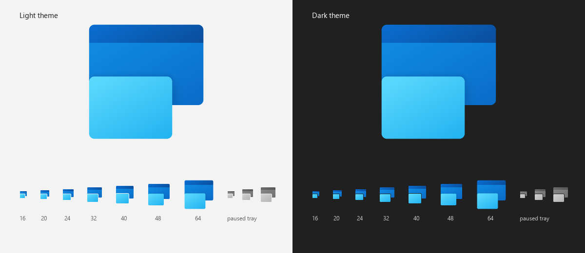

# Enhanced Snap — Design

## 1. Problem

Microsoft Edge windows arranged with Windows Snap (the screenshots the project started from):

| Observation | Cause |
| --- | --- |
| Windows touch each other and the screen edges | Windows Snap tiles without spacing |
| Snapped windows have **square** corners | DWM squares the corners of maximized and *arranged* (snapped) windows |
| Edge draws a rounded, inset content frame inside a square window | Edge adopted Fluent 2 "rounded content" (the thread in the brief: the flag that hid it is gone) |
| Doubled 1 px borders between neighbours, cramped quadrants | No gap, two borders meeting |

The mismatch isn't Edge's design; it's the window manager around it. Enhanced Snap fixes it there: windows stay
in the **normal** state (so DWM keeps the 8 px radius), are separated by **even gaps**, and the snapping UI
uses Fluent 2 materials and motion.

## 2. Fluent 2 decisions

| Token | Value | Where |
| --- | --- | --- |
| Corner radius | 8 px (Fluent *Large*, Windows 11 window radius); 4 px option (*Medium*) | Zone tiles, drop target, `DWMWA_WINDOW_CORNER_PREFERENCE` |
| Spacing | 8 epx default gap and margin, 0–32 in 2 px steps (4 px grid) | `ZoneMath.ComputeZones` |
| Strokes | 1 px tile stroke, 2 px accent stroke on the drop target (Fluent *Thin*/*Thick*), 2/3 px in high contrast | `OverlayPalette` |
| Materials | **Acrylic** for the transient zones overlay, **Mica** for the long-lived settings window, **Solid** fallback | `OverlayPalette`, `MainWindow` |
| Color | Accent: `AccentDark1` (light) / `AccentLight2` (dark) from `UISettings`; neutral tints `#F3F3F3` / `#202020` | `OverlayPalette` |
| Motion | Enter 167 ms decelerate `(0,0,0,1)`; exit 100 ms accelerate `(0.7,0,1,0.5)`; drop target glide 150 ms | `FluentMotion` |
| Theme | Zones follow the *Windows* mode (shell chrome); settings follow the app mode | `SystemState` |
| Typography/controls | WinUI 3 defaults (Segoe UI Variable, `SettingsCard`, NavigationView) | Settings app |

Material fallbacks mirror WinUI's own acrylic rules: solid when transparency effects are off, in Energy saver,
in high contrast (system colors only) and in Remote Desktop sessions.

## 3. Architecture

```
┌──────────────────────── EnhancedSnap.exe (always running, NativeAOT, ~7 MB idle) ───────────────────────┐
│ EngineHost      hidden top-level window + GetMessage loop (broadcasts, tray, IPC, power)                 │
│ WindowsSnap…    WindowsSnapOverride: SPI_SETWINARRANGING off while running, restored on every exit path  │
│ SnapEngine      WinEvent MOVESIZESTART/END → drag session → edges / snap bar / zones → WindowPlacer      │
│ GroupManager    snap groups: GroupFrame (click-through base), DividerLayer (hover bars, drag placeholders,│
│                 min-size limits), TaskbarGroups (previews in the apps' taskbar thumbnails), lifecycle    │
│ Popups          LayoutFlyout, SnapAssist (composition + Direct2D text on WARP, DWM thumbnails)          │
│ OverlayManager  one click-through ZoneOverlay per monitor (Windows.UI.Composition, DesktopWindowTarget)   │
│ InputHook       own HighQoS thread: WH_KEYBOARD_LL (Win+Arrow/Z) and WH_MOUSE_LL (maximize hover), each  │
│                 only while a setting needs it                                                            │
│ TrayIcon        Shell_NotifyIcon v4, themed Win32 menu                                                   │
│ Elevation       administrator mode: scheduled task, message filter, unelevated launches                  │
│ SystemState     theme, accent, transparency, animations, high contrast, RDP, Energy saver                │
└──────────────────────────────────────────────▲──────────────────────────────────────────────────────────────┘
                                               │ WM_APP messages to known window classes (no sockets, no polling)
┌──────────────────────── EnhancedSnap.Settings.exe (on demand, WinUI 3, NativeAOT) ──────────────────────────┐
│ MainWindow (Mica) → pages → SettingsViewModel → settings.json (atomic replace, 180 ms debounce)              │
│ EngineClient: "settings changed", "preview zones on HMONITOR"; MessageWindow: "reload", "activate page"     │
└─────────────────────────────────────────────────────────────────────────────────────────────────────────────┘
EnhancedSnap.Core (shared): settings model + source-generated JSON, layout catalog, ZoneMath, displays, strings
```

Two processes keep the always-on part tiny: the XAML framework is only loaded while the settings window is open.

### Drag flow

1. `EVENT_SYSTEM_MOVESIZESTART` (out-of-context, no injection). Resize vs. move is told apart by the system
   resize cursors. Snapped windows get their floating size back immediately (*restore on unsnap*).
2. For the drag only: a `LOCATIONCHANGE` hook scoped to the window's thread + a 33 ms timer for Shift/Ctrl.
   The thread switches to HighQoS.
3. Activation (`Shift` held, or always unless Shift) → overlay is inserted **directly below the dragged
   window** in z-order; the drop target glides between zones; <kbd>Ctrl</kbd> spans
   (`ZoneMath.SpanSelection` closes the selection to a rectangle).
4. `EVENT_SYSTEM_MOVESIZEEND` → Esc-cancel detection → `WindowPlacer.Place` → record → overlay fades out →
   hooks/timer removed → EcoQoS again.

### Keyboard flow

The LL hook only looks at arrow keys with Win held. It decides synchronously (cheap, thread-safe:
style bits, cached process names, concurrent snap records) whether to swallow, posts the action to the engine
thread and injects an unassigned key (0xFF, tagged) so releasing Win doesn't open Start. Floating/maximized
windows pass Win+↑/↓ through to Windows.

## 4. Geometry

For a work area minus margin `inner` and gap `g`, a fractional edge `f` maps to
`P(f) = inner.Left + f · (inner.Width + g)`, and zone `[f0, f1]` becomes `[P(f0), P(f1) − g]`.
Shared edges are rounded once, so neighbours are exactly `g` pixels apart and a full-width zone ends exactly at
the inner edge (unit tested for every template, several DPIs and 0 spacing).

Placement targets the **visible frame** (`DWMWA_EXTENDED_FRAME_BOUNDS`): invisible resize borders are measured
per window and added back. Maximized, minimized and Windows-Snap *arranged* windows are first restored with
`SetWindowPlacement` (workspace coordinates). A second pass fixes windows whose DPI — and border width —
changed when moving to another monitor. Non-resizable windows are centered in the zone.

All processes are Per-Monitor V2 DPI aware; every rectangle is in physical pixels; spacing and radii are
scaled by each monitor's DPI.

## 5. Energy & performance

| Situation | Cost |
| --- | --- |
| Idle | No timers, no polling; blocked in `GetMessage`; EcoQoS; 6.8 MB private memory measured; about 12 MB with a snap group and its thumbnails |
| Typing (Win+Arrow override on, or groups in the taskbar) | One LL-hook callback per key on a dedicated thread; other keys return immediately (Tab only checks for a held Alt or Win) |
| Moving the mouse (maximize hover / Snap Assist on) | One LL-hook callback per mouse message on the same thread, which only resets a timer; a single `WM_NCHITTEST` after 300 ms of rest |
| Dragging | Per-drag hooks + 33 ms modifier check; overlay animations run in DWM's compositor |
| Overlay visible | GPU composition only; acrylic replaced by solid in Energy saver / RDP / transparency off |
| Text popups (Snap Assist) | Direct2D on a WARP (software) device created on first use — no graphics driver in the engine (12.6 MB with a popup open vs 54 MB on the hardware device); popups close their surfaces on hide; device released by a one-shot timer 60 s after the last popup |
| Snap group at rest | Base, divider layer and overlay are composition visuals; Mica comes from the system's blurred wallpaper (sampled once); nothing redraws while idle |
| Divider drag | One window resizes live (16 ms throttle, `SWP_ASYNCWINDOWPOS`); the others are placeholders until release |
| Group thumbnails (taskbar, Alt + Tab, Task View) | One minimized proxy window per group and app; one snapshot per group, rendered (PrintWindow + GDI) on a pool thread 0.8 s after the group forms, changes or is used, and scaled into each request instantly |
| Group peek (taskbar preview with the group open) | One full-screen capture from the same pool-thread pass (16 MB at 2560 × 1600), freed 20 s after the preview: 27 MB → 12.5 MB measured |
| Filling a group's gap while dragging | One rectangle test per drag frame against the shown groups' empty zones |
| Settings window | Separate WinUI process, exits when closed; Mica; 5 s after it loses focus: EcoQoS + compacted heap + trimmed working set |

Energy saver is tracked with `RegisterPowerSettingNotification(GUID_ENERGY_SAVER_STATUS)` (Windows 11 24H2+)
and `GUID_POWER_SAVING_STATUS` (older builds) — event driven.

## 6. Security & permissions

- No DLL injection, no services, no network access. Elevation only when the user turns on *Snap apps running as
  administrator* (section 7, Administrator mode).
- Per-user install; settings and logs under `%LOCALAPPDATA%\EnhancedSnap` (the Store package's copy is redirected to
  its own folder, section 9).
- Low-level hooks exist only while a setting needs them and snapping isn't paused: the keyboard hook for
  *Use Win + arrow keys* / the Snap replacement (it reacts to Win + arrows and Win + Z only), the mouse hook for
  maximize-button hover and Snap Assist (pointer position and button-down only). Nothing is recorded or stored.
- Without administrator mode, windows of elevated apps are left alone (UIPI); the user gets a one-time notification
  per app that points to the setting.

## 7. Replacing Windows Snap

### Takeover

`WindowsSnapOverride` flips `SPI_SETWINARRANGING` — the same switch as Settings → Multitasking → *Snap windows* —
which disables every built-in Snap surface at once (edges, flyout, snap bar, Snap Assist, groups, Win + Arrow / Z).
The per-feature registry values were rejected because they only apply after an Explorer restart. A marker file
records that we turned it off; the previous value is restored on pause, quit, unhandled exception, next start after a
crash, and by the uninstaller (`--restore-snap`). If the user re-enables Snap externally, we stand down. The Store
package can't run anything at uninstall, so there the switch is changed for the sign-in only (no
`SPIF_UPDATEINIFILE`): the saved value never changes, and signing out restores it whatever happened to the app.
Checked on a registered package: with the in-memory change alone, Win + Left and dragging to an edge stop snapping,
Win + Z shows no flyout, and Windows Settings shows *Snap windows* off; removing the app while it runs closes it, so
it restores the switch itself.

### Snap groups

```
SnapGroup = { monitor, layout, zone fractions (divider-adjusted), members: hwnd → zone indices }
Join(window, layout, zones): most recent group of that layout with the zones free → else displace → else new
```

Z-order of a raised group, top to bottom: `[divider input][overlay][members…][base]`.

* **Base** (`GroupFrame`): directly behind the bottom-most member, `WS_EX_LAYERED | WS_EX_TRANSPARENT` and
  `HTTRANSPARENT` — purely visual, never hit-tested or activated, so a click on a gap or margin reaches what is below
  (an early preview handled clicks and offered an "Ungroup" menu; activating the base for that menu pulled it over
  every window).
  Material (`GroupMaterials`): Mica / Mica Alt = the system's blurred-wallpaper brush + tint, Acrylic = host backdrop +
  tint, Solid; all solid without transparency, in Energy saver, high contrast, RDP. Radius = 8 px + padding (concentric).
* **Divider input** (`DividerLayer`): a window without a redirection bitmap whose `SetWindowRgn` region is exactly the
  gaps, so it can never take a click meant for an app (a point 3 px inside a window still goes to the window).
* **Overlay**: click-through. Hover shows the divider's acrylic bar (gap + 4 epx each side) with a 36 × 4 epx grip;
  during a drag it covers the group with the base material plus wallpaper placeholders and sits right below the live
  window (the front-most member touching the divider), like Windows Snap; release places everything, then fades.
* **Limits**: `GroupGeometry.DividerRange` over member rectangles. Each member's minimum along the axis =
  max(app minimum from `WM_GETMINMAXINFO` — marshalled across processes, minus invisible borders, a quarter of the
  display's shorter side). `FitMinimums` applies the same limits when a window joins.
* **Dividers**: `GroupGeometry.FindDividers` returns maximal shared edges, so a 2×2 grid has one full-length vertical
  and one horizontal divider. Live resizing is throttled to 16 ms with `SWP_ASYNCWINDOWPOS`.
* **Lifecycle**: foreground → raise the group as a unit; minimize, maximize, cloak (another virtual desktop) → base and
  dividers hide; close / maximize / moved away → member leaves. Hooks are scoped to member processes only.
* **Filling a gap**: while a window is dragged, `GroupManager.EmptyZoneAt` checks whether the pointer is over a
  zone of a shown group that no member covers (left free, or its window closed). The overlay then shows a neutral
  (non-accent) preview of that space, and dropping calls `SnapInto(…, into: group)`, so the window joins *that* group
  rather than starting a new one; `FitMinimums` applies as for any join. Edge snapping keeps priority at the screen
  edges.
* **Empty space**: dividers run between members only, so moving one leaves the empty zones beside it where they
  were — a strip nobody owns opens up, or a member grows over the empty zone. `GroupGeometry.FreeSpace` cuts an empty
  zone back to the largest part no other zone overlaps and grows it to the nearest zones; gap filling, Snap Assist and
  `Join` (which adopts it as the zone's new fractions) all use that space.

### Taskbar, Alt + Tab and Task View

`TaskbarGroups` creates, per group and per app in it, a minimized proxy window carrying that app's AppUserModelID, so
the taskbar files it under the app's button. `DWMWA_FORCE_ICONIC_REPRESENTATION` + `HAS_ICONIC_BITMAP` make the shell
ask for a thumbnail (`WM_DWMSENDICONICTHUMBNAIL`) — the taskbar flyout, Alt + Tab and Task View alike — and, when the
pointer rests on the taskbar thumbnail, for a live preview (`WM_DWMSENDICONICLIVEPREVIEWBITMAP`, the peek). The
proxy's restored rectangle (`rcNormalPosition`, set while a guard lets it through the handler that keeps the proxy
off-screen) is the group's work area: DWM draws the peek there, and Task View shapes the card like the display. The
thumbnail is each member via `PrintWindow(PW_RENDERFULLCONTENT)` at its scaled position over the wallpaper
(`Wallpaper`: the current wallpaper decoded once with GDI+, cropped like *Fill*; the frame color without one), with
rounded corners; icons for minimized, hung or elevated windows.

**Peek**. The live preview is a premultiplied bitmap the size of the work area: the members at full size where
they are (their real frame bounds), opaque with Windows 11's 8 epx rounded corners, a soft 16 epx shadow, and a faint
line where the capture paints a standard frame's border black; everything else transparent, so the real desktop shows
through, as with Windows' own groups. A late answer makes DWM show a blank placeholder window, so the request is
answered at once — with the last full-size capture, or the snapshot scaled up — and a full-resolution render (same
pool thread, same capture pass as the snapshot) replaces it with `DwmSetIconicLivePreviewBitmap` while the peek is
still on screen. The capture is started already when the taskbar flyout asks for the group's thumbnail (a thumbnail
request while the pointer is on the taskbar), so it is normally ready before the pointer comes to rest on the group. Full-size captures are dropped when the arrangement changes and freed 20 s after the last peek (then
`DwmInvalidateIconicBitmaps`, so DWM asks again instead of showing old content). The group base and dividers are not
`DWMWA_EXCLUDED_FROM_PEEK` (the previews excluded them): during any peek they hide with the windows instead of staying
behind as a pale panel.

**Close.** `WM_CLOSE` / `SC_CLOSE` on a proxy — the X in the taskbar preview, Alt + Tab or Task View — posts
`SC_CLOSE` to every member, as their own close buttons would; members that stay open (an app asking to save) stay
grouped.

**Snapshots.** Task View waits only briefly for a thumbnail: an answer about 300 ms late leaves a black card that is
never updated (measured with a probe window), and PrintWindow waits on every member app. So each group keeps one
snapshot (up to 800 × 500), rendered on a pool thread from inputs captured on the UI thread — when the proxies are
created, and 0.8 s after the group changes or a member is activated (one timer, restarted by each change). Requests are
answered at once by scaling the snapshot; a snapshot older than 3 s is re-rendered after it has been shown, and every
finished render calls `DwmInvalidateIconicBitmaps` so an open flyout asks again. Before the first snapshot exists, a
request gets the wallpaper and app icons, which need no app.

Activating (or restoring) a proxy — clicking it in the taskbar, Alt + Tab or Task View — restores and raises the group,
then re-minimizes the proxy. The first proxy of a group is activatable (Alt + Tab and Task View list the group once);
the others are `WS_EX_NOACTIVATE`.

**Order**. Alt + Tab and Task View order windows by the shell's last-activation time, not the z-order (keeping
proxies behind the group's windows in the z-order changes nothing): a proxy never activated is listed last,
and the shell offers no way to set the time from outside (`IApplicationView::SetLastActivationTimestamp` and
`SetShowInSwitchers` return `E_NOTIMPL`). So the input thread holds back the first Tab of plain Alt + Tab or Win + Tab
pressed in a group window (`IInputPolicy.SwitcherProxy`, a member → proxy map published by `Sync`) and the engine
activates the group's proxy first (`SwitchToThisWindow`, after a dummy key so Windows grants this process the
foreground), waits one tick for the shell to record it (1–2 ms after the activation, measured), and replays the Tab.
The group is then first, as Windows lists its groups. For Alt + Tab one extra Tab is replayed, so the selection lands
where Windows would have put it — the window before the one the user was in — and a quick Alt + Tab behaves as
always. When the modifier is released and the proxy (or, since it is minimized, the taskbar) still has the
activation — Esc, or the group picked — the group is brought back. The taskbar flyout lists an app's windows in the
order they appeared; reordering them means removing and re-adding the windows (`ITaskbarList::DeleteTab`/`AddTab`),
which was measured to erase their overlay badges and progress bars, so the group stays after them there.
`AppIds` resolves a window's ID from its window property store, its package, or its executable path (known-folder or
full path) and **only uses IDs a running taskbar button shows** (UI Automation, `Appid: …`), so a wrong guess never
creates a stray button. Process-wide explicit IDs (`SetCurrentProcessExplicitAppUserModelID`) can't be read from
outside, so those apps get no preview.

### Administrator mode

Windows only lets a process move windows at its own integrity level or below. With the setting on, the settings app
runs `EnhancedSnap.exe --register-elevated` once through UAC: it registers a scheduled task (on demand, highest
privileges, interactive token, priority 4, no time limit), closes the running engine and starts the task. Later
unelevated starts (sign-in, Start menu) hand over to the task. The elevated engine allows the settings app's IPC,
the tray callback, `TaskbarCreated`, `WM_SETTINGCHANGE` and `WM_CLOSE` through `ChangeWindowMessageFilterEx`, and
starts the settings app unelevated with the shell's token. Turning the setting off sends `EngineDropElevation`: the
engine deletes the task and restarts unelevated (`--after <pid>` waits for the old process).

### Popups

`PopupWindow` = topmost, non-activating, DWM-rounded (`DWMWCP_ROUND`) with `CS_DROPSHADOW`, acrylic via host backdrop
+ tint. Text and icons are Direct2D/DirectWrite drawing surfaces inside the same composition tree
(`DrawingSurfaces`, raw COM vtables, on a WARP device so the engine never loads the graphics driver); live previews
are DWM thumbnails. Content is rebuilt on every show and its surfaces are closed on hide (wrappers would otherwise pin
memory until a garbage collection); the device is created lazily and released one minute after the last popup, or
recreated after a device loss.

Maximize-button hover: the input thread resets one timer per mouse move and, after 300 ms of rest, sends a single
`WM_NCHITTEST` to the window under the pointer — `HTMAXBUTTON` is the contract custom-frame apps already implement for
Windows' own flyout.

The layouts flyout follows Windows' own: layouts sit directly on the acrylic panel
(`AcrylicBackgroundFillColorBase`) without cards, two per row (three when the display is 2.1:1 or wider; one row in
drag mode), zones are `ControlAltFillColorQuarternary` with a `ControlStrongStrokeColorDefault` outline and 4 epx
radius, and the hovered zone takes the accent fill and stroke. It offers Windows' layouts for the screen —
four under 1920 effective pixels wide (halves, 2/3 + 1/3, half + two stacked, quarters), six above — in cards of about
3:2, and a first row of **snap suggestions**: the window beside the most recent other window, and beside the two most
recent stacked, their zones `ControlFillColorDefault` with the app's icon. A suggestion is hovered and chosen as a
whole: the window and the suggested windows are snapped into one group, the window in front.

## 8. Product icon

One design, rendered by `tools/make_icons.py` into every asset (`assets/` for the executables, tray, MSI and settings
app; `packaging/Images/` for the MSIX), to Windows 11's app-icon guidelines:



- **Metaphor**: a window with a dark-blue title bar (the WinUI Gallery icon's) and a cyan window snapped in front of it,
  flush with the left and bottom edges: two layers, one idea. It keeps the demo icon's stagger, with its top ribbon
  turned into the title bar.
- **Grid**: 48 px, live area 2–46. Back window 2,2–46,33 with a 7 px title bar; front window 2,22–34,46; exterior
  corners 2 px.
- **Colour**: the cyan blue of Windows' own utilities (WinUI Gallery, Quick Assist, Live captions), one 120° gradient
  per layer, light at the top left: title `#0A6FD2 → #0B4E9C`, body `#1290E6 → #0A6CC8`, front `#5EDCFF → #22B2F0`.
  57 % of the icon has 3:1 contrast against the light theme and 84 % against the dark theme; the script fails below
  50 %.
- **Depth**: the front window casts the two-part "separate metaphor" shadow (0 px offset / 2 px blur at 20 %,
  2 px / 4 px at 22 %), masked into the window below. Nothing falls on the background, which stays transparent
  (unplated).
- **Small sizes**: below 48 px every edge snaps to the pixel grid, the title bar keeps at least 2 px, and the shadow
  becomes a one-pixel gap around the front window. The ICO has frames from 16 to 256 px for every DPI; the settings
  title bar loads the PNG made for its display scale (16–48 px); the paused tray icon is the same art in Fluent
  neutrals.
- **Store**: `Square44x44Logo` at target sizes 16–256. The `altform-unplated` and `altform-lightunplated` variants
  (taskbar, Start) are the art itself. The plain variant is what lists such as *Settings → Apps → Startup* draw on a
  plate in the user's accent colour, so it keeps the art at two thirds of the plate; edge to edge, the plate would only
  show in the art's open corner and look like a mistake. Tiles, Store logo and splash screen at scales 100–400.

## 9. Distribution

| | MSI and ZIP (GitHub) | MSIX (Microsoft Store) |
| --- | --- | --- |
| Identity | none | package identity (`AppInfo.IsPackaged`: `GetCurrentPackageFamilyName`) |
| Launch at sign-in | HKCU `Run` value (+ `StartupApproved`) | `windows.startupTask` driven through `StartupTask`; an "off" set in Windows Settings wins |
| Windows Snap takeover | `SPI_SETWINARRANGING` saved to the profile, restored by the uninstaller | the same switch for the sign-in only: there is no uninstall hook |
| Administrator mode | scheduled task | not offered (the task would start the engine outside the package) |
| Settings and logs | `%LOCALAPPDATA%\EnhancedSnap` | the same path, redirected by Windows to the package's `LocalCache`; Explorer is pointed there |
| Windows App SDK classes | the exe's side-by-side manifest (registration-free WinRT) | also registered in the package manifest, generated from that manifest by `packaging/build-msix.ps1` |
| XAML and logo resources | `EnhancedSnap.Settings.pri` | `resources.pri` = the logos + `EnhancedSnap.Settings.pri`, merged by makepri |
| Upgrades | MSI major upgrade (upgrade code `581B8709-…`); removes the previews (`7E4B9C2A-…`) | the Store |

## 10. Testing

- `tests/EnhancedSnap.Core.Tests`: zone geometry, gaps at several DPIs, spanning, keyboard navigation, custom
  layouts, settings JSON round-trip and normalization, exclusion rules, translation completeness.
- `tools/placetest.ps1`: live placement and Win+Arrow test against a running engine in **test mode**
  (`ENHANCEDSNAP_TEST_WINDOW_TITLE` — the engine then touches only the disposable test window).
- `tools/probe.ps1`: preview zones / capture screenshots; `tools/movetest.ps1`: keyboard move-loop drag test.
- `tools/grouptest.ps1`: groups in test mode through engine debug messages — base click-through and gap hit tests,
  hover bar, held divider drag (placeholders), minimum-size clamping, Snap Assist, gap filling, taskbar preview
  (written to a BMP).
- `tools/switchertest.ps1`: snap suggestions, the group peek (through `DwmpActivateLivePreview`, as the taskbar
  does), Win + Tab / Alt + Tab order with injected keys, and X closing the group — test windows only.
